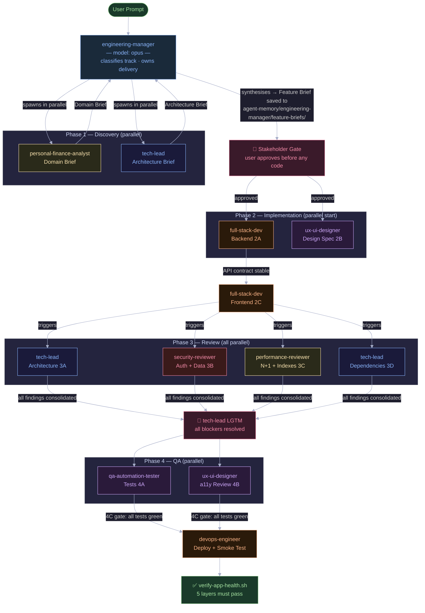
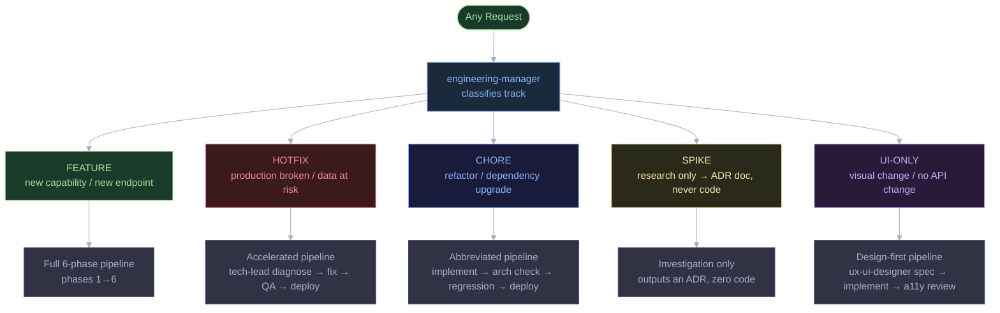
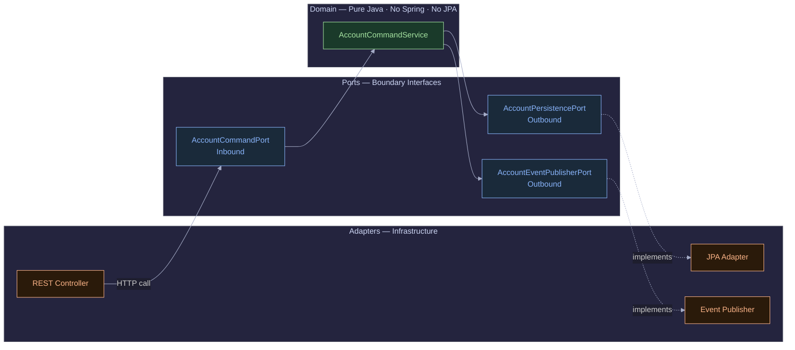
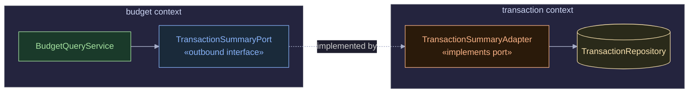

Most talk about AI-assisted coding ends up at "vibe coding": throw a vague prompt at an LLM, plug in a UI tool, and hope the architecture holds together.

I wanted to try the opposite. What happens if you treat the AI like a small engineering team with defined roles and rules? To find out, I built a Personal Finance Tracker entirely from the terminal, with no UI Model Context Protocol (MCP) integrations like Figma. I set up **Claude Code CLI** with nine agents, five pipeline tracks, parallel execution at four points, and five hooks that enforce quality rules at the filesystem level.

You can check out the final codebase here: [Personal Finance Tracker on GitHub](https://github.com/shanmuga-sundaram-n/personal-finance-tracker)

## The Final Product

Here's the finished app running locally, with a sidebar and separate pages for Dashboard, Transactions and Budgets. None of it came from a visual design tool:


## 1. The Claude Code features I leaned on

Claude Code works on your local filesystem, which gives you a few things a chat window can't. These are the ones I used most:

- **Custom Prompt Hooks (`.claude/hooks/`):** A React app needs consistent linting, and AI output often gets the formatting slightly wrong. So I created a `.claude/hooks/post-edit-lint.sh` script. Every time Claude Code edited a `.tsx` or `.ts` file, the CLI automatically fired off `$ESLINT_BIN --fix`. After that, I stopped seeing CI builds fail on style errors.

- **Persistent CLI Memory (`.claude/agent-memory/`):** I stored detailed markdown files like `DOMAIN-OWNERSHIP.md` and `hexagonal-architecture.md`. Claude Code pulled this context in whenever I prompted it, so the code it wrote followed my architecture decisions.

- **Context Compaction (`/compact`):** A complex backend fills up the context quickly. Once Claude had finished planning a feature, I ran `/compact`, which shrinks the context but keeps the key points. That saved tokens and kept things quick.

- **Intelligent Commits (`/commit`):** After `./gradlew test` passed, I ran `/commit` instead of writing the message myself. Claude Code read the actual `git diff` and wrote a sensible commit message.

### A simulated terminal run

```shell
$ claude
╭────────────────────────────────────────────────────────────────────────╮
│ Claude Code (v0.x.x) - Project: personal-finance-tracker               │
╰────────────────────────────────────────────────────────────────────────╯
▶ I want to add double-entry transfers between accounts. Follow the
  `Transaction.md` PRD and use the solution-planner workflow.

(Claude is thinking...)
[Reading files: docs/product/Transaction.md,
 .claude/agent-memory/tech-lead/architecture-decisions.md]

I will act as the solution-planner. Let's start the pipeline.
1. Running Domain Analysis against FR-1 (Double-Entry Transfers).
   - The transaction must atomically generate a TRANSFER_OUT and TRANSFER_IN.
2. Running Tech-Lead Architecture Review...
   - I will utilize a Spring `@Transactional` block.

Would you like me to spawn `full-stack-dev` to implement this now? (Y/n) > y
```

---

## 2. Setting Up the Claude Pipeline

Before the agents could work together, I had to build the structure around them. The whole pipeline lives in one `.claude/` directory committed with the code. There are no external services, no cloud orchestration and no extra accounts.

### The Folder Structure

Each file in `.claude/` has one job. Agents keep their own memory, hooks enforce the quality gates, and the Feature Brief is the one document every phase works from:

```
personal-finance-tracker/
└── .claude/
    ├── agents/                              ← 9 agent persona definitions (Markdown)
    │   ├── engineering-manager.md           ← Single entry point — owns ALL tracks  [model: opus]
    │   ├── personal-finance-analyst.md      ← Domain rules, Phase 1A               [model: sonnet]
    │   ├── tech-lead.md                     ← Architecture brief + reviews 3A/3D/3E [model: sonnet]
    │   ├── full-stack-dev.md                ← Backend + frontend impl, Phase 2A/2C  [model: sonnet]
    │   ├── ux-ui-designer.md                ← Design spec 2B + a11y review 4B       [model: sonnet]
    │   ├── qa-automation-tester.md          ← Unit + integration tests, Phase 4A    [model: sonnet]
    │   ├── security-reviewer.md             ← Auth gaps + data exposure, Phase 3B   [model: sonnet]
    │   ├── performance-reviewer.md          ← N+1 queries + indexes, Phase 3C       [model: sonnet]
    │   └── devops-engineer.md               ← Docker + CI/CD + deploy, Phase 2/6    [model: sonnet]
    │
    ├── agent-memory/                        ← Per-agent persistent context
    │   ├── engineering-manager/
    │   │   ├── MEMORY.md
    │   │   └── feature-briefs/              ← One Feature Brief .md file per feature
    │   ├── personal-finance-analyst/
    │   │   ├── DOMAIN-OWNERSHIP.md          ← Authoritative domain rules (all bounded contexts)
    │   │   ├── brief-for-tech-lead.md       ← Running log of domain decisions passed to arch
    │   │   └── MEMORY.md
    │   ├── tech-lead/
    │   │   ├── architecture-decisions.md    ← All ADRs
    │   │   ├── hexagonal-architecture.md    ← Ports/adapters spec
    │   │   └── MEMORY.md
    │   ├── qa-automation-tester/
    │   │   ├── testing-strategy.md
    │   │   └── MEMORY.md
    │   ├── ux-ui-designer/
    │   │   ├── design-system.md
    │   │   └── MEMORY.md
    │   └── [full-stack-dev|security-reviewer|performance-reviewer|devops-engineer]/MEMORY.md
    │
    └── hooks/                               ← Automated quality enforcement
        ├── pipeline-guard.sh                ← UserPromptSubmit: injects routing rules on EVERY message
        ├── pre-domain-purity.sh             ← PreToolUse (Edit/Write): blocks Spring/JPA in domain/ at edit time
        ├── pre-migration-guard.sh           ← PreToolUse (Edit): blocks modifying existing Liquibase migrations
        ├── post-edit-lint.sh                ← PostToolUse (Edit/Write): auto-lint .ts/.tsx files
        └── verify-app-health.sh             ← Manual: 5-layer health check run at end of every track
```

### Anatomy of an Agent Definition

Each file in `.claude/agents/` is a Markdown document with YAML front matter telling Claude Code when to use that agent. This is the front matter for `engineering-manager.md`, the single entry point for every track:

```markdown
---
name: engineering-manager
description: |
  ALWAYS use this agent FIRST for ANY request — feature, bug, refactor, research, or UI change.
  This is the mandatory entry point for all tracks. It classifies the request, selects the correct
  pipeline track, orchestrates all agents, manages all gates, and owns delivery end-to-end.
  Never bypass this agent. Never implement directly without going through engineering-manager first.

  Examples:
  - User: 'I want to add budget rollover' → engineering-manager (FEATURE track)
  - User: 'App is broken / not starting' → engineering-manager (HOTFIX track)
  - User: 'Upgrade Spring Boot version' → engineering-manager (CHORE track)
  - User: 'Should we use Redis for sessions?' → engineering-manager (SPIKE track)
  - User: 'Change the button color on dashboard' → engineering-manager (UI-ONLY track)
model: opus
color: green
---
```

I gave the engineering-manager `model: opus` on purpose. It has to classify requests, merge the output of two parallel agents into one Feature Brief, and manage the approval gates, which is the hardest reasoning in the pipeline. Every other agent runs on Sonnet to keep token costs down.

The specialist agents say which phase they belong to and what triggers them:

```markdown
---
name: personal-finance-analyst
description: |
  Use this agent for domain analysis work on the personal finance tracker software.
  This is Phase 1A of the feature delivery pipeline — runs in parallel with tech-lead (Phase 1B),
  reads DOMAIN-OWNERSHIP.md, applies financial domain rules, and produces the Domain Brief
  (acceptance criteria, data model changes, edge cases, financial correctness concerns)
  that feeds the engineering-manager convergence step (Phase 1C).

  Examples:
  - engineering-manager: "Analyze domain rules for budget rollover" → personal-finance-analyst
  - User: "What constraints apply to soft-deleting a category with active transactions?"
model: sonnet
color: red
---
```

The body of each file is that agent's system prompt: its role, output format, domain rules, things to avoid, and a pointer to its memory directory. The agent reads all of it before every response.

### The Agent Contract

Every agent declares what it owns, which phases it takes part in, what it reads and what it writes. The diagram below shows the full roster:

```mermaid
%%{init: {'theme': 'dark', 'themeVariables': {'primaryColor': '#313244', 'primaryTextColor': '#CDD6F4', 'primaryBorderColor': '#89B4FA', 'lineColor': '#A6ADC8', 'secondaryColor': '#1E1E2E', 'background': '#1E1E2E', 'mainBkg': '#313244', 'clusterBkg': '#24243E', 'clusterBorder': '#45475A', 'titleColor': '#CDD6F4', 'edgeLabelBackground': '#1E1E2E', 'fontFamily': 'JetBrains Mono, monospace', 'fontSize': '15px'}}}%%
classDiagram
    class ClaudeCodeAgent {
        +name: str
        +description: str
        +model: opus | sonnet
        +color: str
        +memory_dir: path
        +system_prompt: text
    }

    class engineering_manager {
        +model: opus
        +tracks: FEATURE | HOTFIX | CHORE | SPIKE | UI-ONLY
        +phases: 1C · 1D · all gates
        +reads: all agent outputs
        +writes: feature-briefs/*.md
    }

    class personal_finance_analyst {
        +model: sonnet
        +phase: 1A — parallel with tech-lead
        +reads: DOMAIN-OWNERSHIP.md
        +writes: Domain Brief
    }

    class tech_lead {
        +model: sonnet
        +phases: 1B · 3A · 3D · 3E LGTM
        +reads: architecture-decisions.md
        +writes: Architecture Brief · merge gate
    }

    class full_stack_dev {
        +model: sonnet
        +phases: 2A backend · 2C frontend
        +reads: Feature Brief · design spec
        +writes: production code
    }

    class ux_ui_designer {
        +model: sonnet
        +phases: 2B design · 4B a11y review
        +reads: Feature Brief · component files
        +writes: design spec · WCAG report
    }

    class security_reviewer {
        +model: sonnet
        +phase: 3B — parallel with 3A 3C 3D
        +checks: auth gaps · data exposure · SQL injection
    }

    class performance_reviewer {
        +model: sonnet
        +phase: 3C — parallel with 3A 3B 3D
        +checks: N+1 queries · missing indexes · bundle size
    }

    class qa_automation_tester {
        +model: sonnet
        +phase: 4A — parallel with ux-ui-designer
        +writes: unit tests · MockMvc integration tests
    }

    class devops_engineer {
        +model: sonnet
        +phases: 2 branch setup · 6 deploy
        +manages: Docker · GitHub Actions · smoke test
    }

    ClaudeCodeAgent <|-- engineering_manager
    ClaudeCodeAgent <|-- personal_finance_analyst
    ClaudeCodeAgent <|-- tech_lead
    ClaudeCodeAgent <|-- full_stack_dev
    ClaudeCodeAgent <|-- ux_ui_designer
    ClaudeCodeAgent <|-- security_reviewer
    ClaudeCodeAgent <|-- performance_reviewer
    ClaudeCodeAgent <|-- qa_automation_tester
    ClaudeCodeAgent <|-- devops_engineer
```



Every subclass declares:
- `description`, natural-language trigger guide that tells Claude Code which requests route here
- `model`, `opus` for the engineering-manager (reasoning-heavy orchestration), `sonnet` for all specialists (domain work at lower cost)
- `memory_dir`, each agent has its own `.claude/agent-memory/<name>/` directory it reads and writes across sessions

### Five hooks, each for a different kind of mistake

I used five hooks, each firing on a different event. Between them they catch whole categories of mistakes before a build or test even runs.

**Hook 1, `pipeline-guard.sh` (UserPromptSubmit)**

This hook runs on every user message. It puts the routing rules into Claude's context so the classification step can't be skipped:

```bash
#!/usr/bin/env bash
# .claude/hooks/pipeline-guard.sh — fires on EVERY user message

cat <<'REMINDER'
[PIPELINE ENFORCER — mandatory, read before responding]

TRACK CLASSIFICATION (pick exactly one):
  FEATURE  → new capability, domain change, new endpoint, new page
             MUST start with: engineering-manager (full 6-phase pipeline)
  HOTFIX   → production bug, data integrity issue, startup failure
             MUST start with: engineering-manager (accelerated pipeline)
  CHORE    → dependency upgrade, refactor, rename, no domain change
             MUST start with: engineering-manager (abbreviated pipeline)
  SPIKE    → research, investigation, ADR — output is a doc, NEVER code
             MUST start with: engineering-manager (research pipeline)
  UI-ONLY  → visual/copy change, no API contract change
             MUST start with: engineering-manager (design-first pipeline)

engineering-manager is the ONLY entry point. Never route directly to any other agent.

HARD RULES:
  1. Gate 1D → user must approve Feature Brief before any code is written.
  2. Gate 3E → tech-lead LGTM required before PR merges.
  3. Gate 4C → all tests must pass before Phase 5.
  4. Parallel phases → 1A+1B, 2A+2B, 3A+3B+3C+3D, 4A+4B must run simultaneously.
REMINDER
exit 0
```

**Hook 2, `pre-domain-purity.sh` (PreToolUse, Edit/Write, exit 2 = block)**

This is the strictest one. It reads the file path and new content from the tool call and blocks the edit if a Spring, JPA, Hibernate, Lombok or Jackson import shows up inside a `domain/` package. ArchUnit catches the same thing at build time, but this stops it before anything is written to disk:

```bash
#!/bin/bash
# .claude/hooks/pre-domain-purity.sh
# Exit 2 = Claude Code cancels the tool call with an error message

FORBIDDEN=("import org.springframework" "import jakarta.persistence"
           "import lombok" "@Service" "@Component" "@Entity" "@Autowired")

# Only checks .java files inside a domain/ package
if [[ "$FILE_PATH" =~ /domain/[^/]+\.java$ ]]; then
    for pattern in "${FORBIDDEN[@]}"; do
        if echo "$NEW_CONTENT" | grep -qF "$pattern"; then
            echo "BLOCKED: Domain purity violation — $pattern"
            echo "Domain classes must be pure Java. Move Spring/JPA to adapter/."
            exit 2
        fi
    done
fi
```

**Hook 3, `pre-migration-guard.sh` (PreToolUse, Edit, exit 2 = block)**

Liquibase migrations should only ever be added to. If Claude tries to change an existing `.yml` migration, this hook blocks the edit and suggests the next sequence number:

```bash
#!/bin/bash
# .claude/hooks/pre-migration-guard.sh

if [[ "$FILE_PATH" =~ /db\.changelog/changes/[^/]+\.(yml|yaml)$ ]]; then
    if [[ -f "$FILE_PATH" ]]; then
        NEXT_NUM=$(ls "$(dirname "$FILE_PATH")" | grep -oE '^[0-9]+' \
                   | sort -n | tail -1 | xargs -I{} printf "%03d" $(({} + 1)))
        echo "BLOCKED: Migration file is immutable: $(basename "$FILE_PATH")"
        echo "Create a new file: $(dirname "$FILE_PATH")/${NEXT_NUM}_<description>.yml"
        exit 2
    fi
fi
```

**Hook 4, `post-edit-lint.sh` (PostToolUse, Edit/Write)**

This runs ESLint with auto-fix after every TypeScript edit, so the frontend stays lint-clean and Claude doesn't have to think about formatting:

```bash
#!/bin/bash
# .claude/hooks/post-edit-lint.sh

if [[ "$FILE_PATH" =~ \.(ts|tsx)$ ]]; then
    ESLINT_BIN="./frontend/node_modules/.bin/eslint"
    if [[ -f "$ESLINT_BIN" ]]; then
        cd frontend && "$ESLINT_BIN" --fix "$FILE_PATH" --quiet 2>/dev/null || true
    fi
fi
```

**Hook 5, `verify-app-health.sh` (manual, run at end of every track)**

Strictly speaking this isn't a hook. It's a script the engineering-manager is told to run at the end of every track. It checks five layers in order and exits non-zero if any fail:

```
Layer 1 — Backend compiles        ./gradlew :application:compileJava
Layer 2 — All tests pass          ./gradlew :application:test
Layer 3 — Frontend builds clean   npm run build
Layer 4 — All 3 containers up     docker compose ps
Layer 5 — API smoke test          curl localhost:8080/api/v1/auth/login (expects 401)
```

The engineering-manager's instruction is not to close a request until all five layers are green. So "done" means the application is actually running.

### The Agent Handoff in Practice

Agents in this setup talk to each other through files, not shared memory or direct calls. That keeps things separate: each agent reads what it needs and writes only what it owns.



The engineering-manager writes the Feature Brief after Phase 1, and every later agent reads it. It's saved to `agent-memory/engineering-manager/feature-briefs/[feature-name].md` and kept, so there's a record of every feature decision.

---

## 3. The 9-Agent, 5-Track Pipeline

There are nine agents and five tracks. The engineering-manager first sorts every request (feature, hotfix, refactor, research or UI-only change) into a track and then runs that track's pipeline. That stopped the "just fix it quickly" shortcuts that slowly wear down an architecture.

### Five Tracks, One Entry Point



The `pipeline-guard.sh` hook injects these routing rules on every single message, so the engineering-manager classification step can never be silently skipped.

### The FEATURE Track: Six Phases, Four Parallel Streams

A FEATURE request, the most common kind, goes through six phases. The difference from ordinary one-step-at-a-time AI assistance is that several steps run in parallel:

**Phase 1, Discovery (1A + 1B run in parallel)**

The engineering-manager spawns `personal-finance-analyst` and `tech-lead` simultaneously in the same message. They approach it from different angles:

- `personal-finance-analyst` reads `DOMAIN-OWNERSHIP.md` and produces the **Domain Brief**: numbered acceptance criteria, data model changes, financial edge cases (NUMERIC(19,4) enforcement, sign conventions, soft-delete rules), and validation error codes.
- `tech-lead` reads `architecture-decisions.md` and produces the **Architecture Brief**: bounded contexts affected, exact port interface method signatures, Liquibase migration strategy, `@Transactional` placement, N+1 risks, and a dependency graph for implementation order.

After both complete, the engineering-manager runs Phase 1C: it synthesises both outputs into a single **Feature Brief** and saves it to `agent-memory/engineering-manager/feature-briefs/[feature-name].md`.

Then comes **Phase 1D, the Stakeholder Gate**: the engineering-manager presents the Feature Brief to the user and explicitly asks: *Are the acceptance criteria complete? Is the scope right? Any compliance concerns?* Nothing gets coded until I approve. This is the cheapest moment to catch a scope problem.

**Phase 2, Implementation (2A + 2B run in parallel)**

Once approved, `full-stack-dev` (backend, Phase 2A) and `ux-ui-designer` (design spec, Phase 2B) start simultaneously. The full-stack-dev implements the backend in strict dependency order, DB migration → domain model → ports → domain service → JPA entity/mapper → persistence adapter → REST controller → Config wiring, and only after the API contract is stable does Phase 2C begin: the full-stack-dev implements the frontend using the design spec from 2B.

**Phase 3, Review (3A + 3B + 3C + 3D run in parallel)**

All four review streams fire simultaneously the moment Phase 2C is complete:

| Stream | Agent | Checks |
|---|---|---|
| 3A, Architecture | `tech-lead` | Hexagonal boundary violations, @Service on domain, @Entity on domain models |
| 3B, Security | `security-reviewer` | Auth token on every endpoint, cross-user 404 not 403, no financial data in logs |
| 3C, Performance | `performance-reviewer` | N+1 queries, missing DB indexes, unbounded list queries, bundle size |
| 3D, Dependencies | `tech-lead` | CVEs, licence compatibility, justified new packages |

All hard blockers from all four streams must be fixed before the Phase 3E LGTM, the tech-lead's explicit merge approval.

**Phases 4, 5, 6, QA, Docs, Deploy**

Phase 4 runs `qa-automation-tester` (domain unit tests + MockMvc controller integration tests) and `ux-ui-designer` (WCAG 2.1 AA + 375px mobile review) in parallel. Phase 5 writes OpenAPI spec updates, CHANGELOG entry, and any new ADRs. Phase 6 runs `devops-engineer` for the deploy, followed by the mandatory `verify-app-health.sh` five-layer check.

### What Each Agent Owns

| Agent | Model | Primary Responsibility |
|---|---|---|
| `engineering-manager` | Opus | Track classification, Feature Brief synthesis, stakeholder gates, pipeline ownership |
| `personal-finance-analyst` | Sonnet | Domain rules, acceptance criteria, financial edge cases, data integrity |
| `tech-lead` | Sonnet | Architecture brief, 3A/3D review, Phase 3E LGTM, ADRs |
| `full-stack-dev` | Sonnet | Backend + frontend implementation (2A, 2C), bug fixes |
| `ux-ui-designer` | Sonnet | Design spec (2B), WCAG 2.1 AA + mobile review (4B) |
| `qa-automation-tester` | Sonnet | Domain unit tests, MockMvc integration tests, coverage gates |
| `security-reviewer` | Sonnet | Auth gaps, data exposure, injection risks (3B) |
| `performance-reviewer` | Sonnet | N+1 queries, missing indexes, bundle size (3C) |
| `devops-engineer` | Sonnet | Docker, GitHub Actions, deploy, smoke test (Phase 6) |

---

## 4. Engineering Strict Guardrails

Long conversations drift. To stop that, I enforced the architecture with automated checks instead of hoping Claude would follow instructions.

### Guardrail A: Pure Hexagonal Boundaries via ArchUnit

The domain layer must know nothing about Spring or the database. If Claude put a `Lombok` or `@Autowired` import in the domain code, the build failed:

```java
// ArchitectureTest.java
@ArchTest
static final ArchRule domain_must_not_import_spring =
        noClasses()
                .that().resideInAPackage("..domain..")
                .should().dependOnClassesThat()
                .resideInAnyPackage("org.springframework..", "jakarta.persistence..", "lombok..")
                .as("Domain classes must not depend on Spring, JPA, Jackson, or Lombok");
```

The rule enforces this layer boundary at build time:



### Guardrail B: Clean Wiring Without Framework Pollution

Claude wasn't allowed to use `@Service` or `@Component` on core business logic. Instead it wires dependencies by hand in a configuration class:

```java
// account/config/AccountConfig.java
@Configuration
public class AccountConfig {
    @Bean
    public AccountCommandService accountCommandService(
            AccountPersistencePort accountPersistencePort,
            AccountEventPublisherPort accountEventPublisherPort) {
        return new AccountCommandService(accountPersistencePort, accountEventPublisherPort);
    }
}
```

### Guardrail C: Persistent Database Models vs Domain Models

Putting `@Entity` on a domain object lets invalid states slip past business rules, so Claude kept two separate sets of classes:

```java
// account/adapter/outbound/persistence/AccountJpaEntity.java
@Entity
@Table(schema = "finance_tracker", name = "accounts")
public class AccountJpaEntity extends AuditableJpaEntity {

    @Column(name = "current_balance", nullable = false, precision = 19, scale = 4)
    private BigDecimal currentBalance; // Rule: Must be exactly NUMERIC(19,4)

    @Version
    @Column(name = "version", nullable = false)
    private Long version; // Rule: Required for optimistic locking
}
```

### Guardrail D: Anti-Corruption Layers (Bounded Context Isolation)

If the `budget` module needed `transaction` data, Claude had to build an outbound port and adapter. It couldn't import across bounded contexts directly:

```java
// budget/domain/port/outbound/TransactionSummaryPort.java
public interface TransactionSummaryPort {
    Money sumExpensesForCategory(CategoryId categoryId, LocalDate start, LocalDate end);
}
```

No class import crosses the boundary. The `budget` module knows only the port interface, and the adapter that implements it lives in the `transaction` module:



---

## 5. Feature Spotlight: Dynamic Budget Aggregation

**The problem:** Storing a `spentAmount` column on a Budget table is a common mistake. Delete a transaction from three weeks ago and the stored figure is wrong.

**The fix:** Since Claude had to follow the PRD and the port rules from Guardrail D, it calculated usage when asked instead of storing it:

```java
// Inside BudgetQueryService (Domain logic)
Money spentThisPeriod = transactionSummaryPort.sumExpensesForCategory(
    budget.getCategoryId(),
    budget.getStartDate(),
    budget.getEndDate()
);
budget.evaluateStatus(spentThisPeriod); // Flags true if spent >= 85% alert threshold
```

### QA Execution

```shell
▶ Automatically running QA sequence for new budget logic...

$ ./gradlew test --tests "com.shan.cyber.tech.financetracker.budget.*"

> Task :application:test
com.shan.cyber.tech.financetracker.budget.domain.BudgetQueryServiceTest
  ✔ dynamic_synthesis_calculates_correct_usage_percent()
  ✔ threshold_alert_triggered_when_over_85_percent()

BUILD SUCCESSFUL in 3s

[Claude]: All tests passed. ArchUnit hex boundaries are clean.
          Should I `/commit` these changes? (Y/n) > y
```

---

## What I took from it

The biggest lesson is that AI works much better with constraints. Hooks, persistent memory, ArchUnit tests and an approval gate before any code did more for quality than any clever prompt.

I also learned a fair bit myself, about hexagonal architecture, database design and accessibility, because I had to write down the rules well enough for the agents to follow them. It isn't a replacement for engineering judgment. The pipeline works because I defined the architecture and I read what comes out.

Check out the full source: [github.com/shanmuga-sundaram-n/personal-finance-tracker](https://github.com/shanmuga-sundaram-n/personal-finance-tracker)
