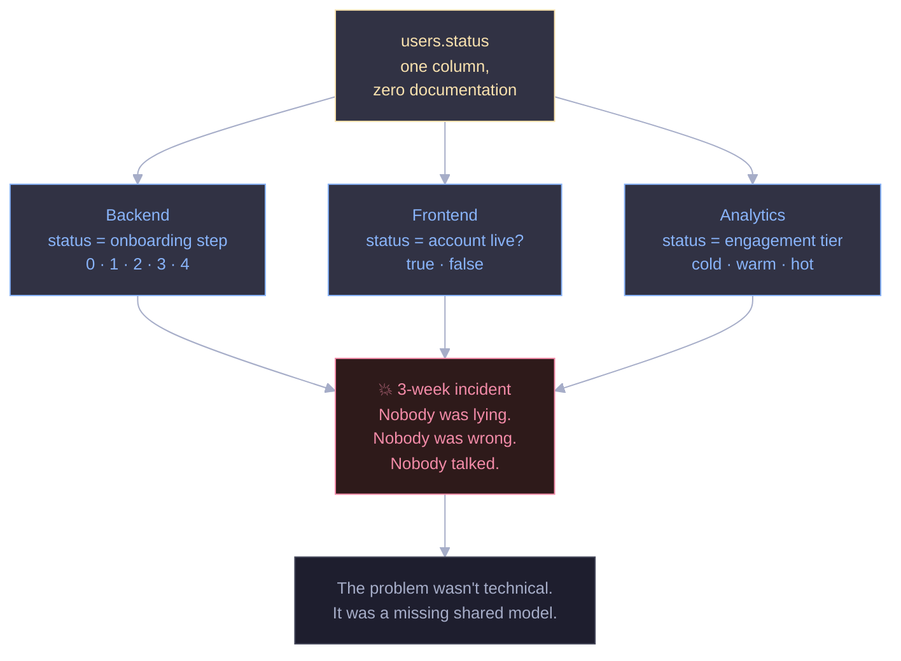
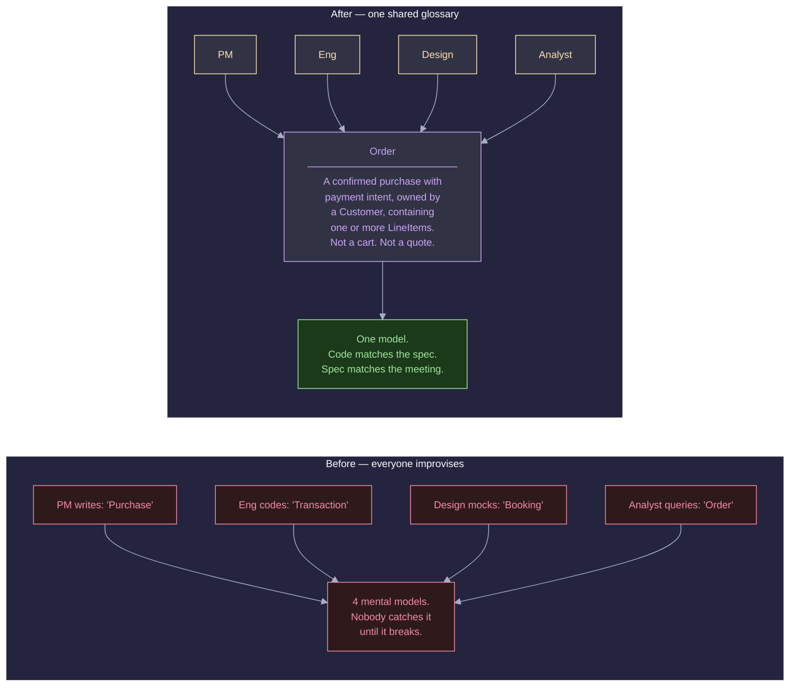
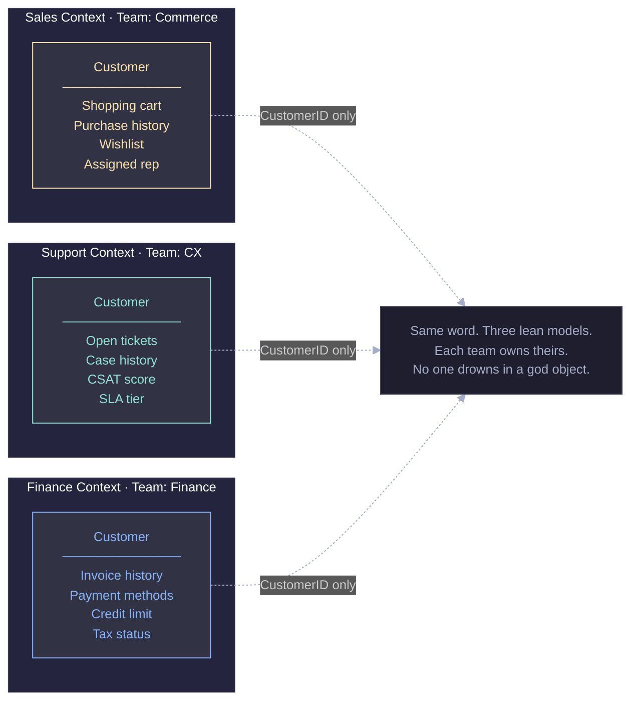
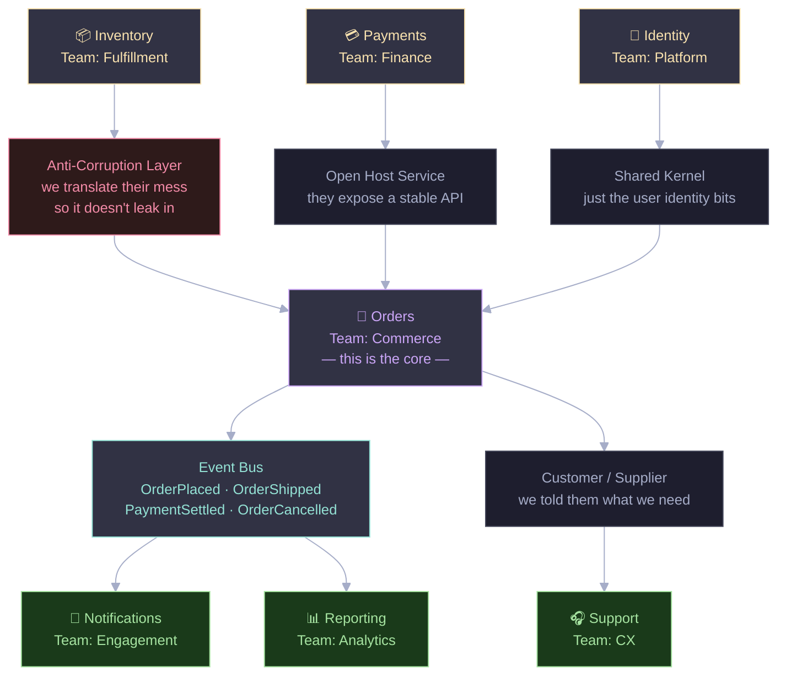
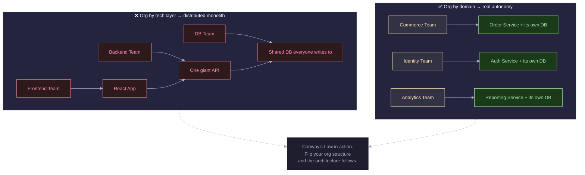
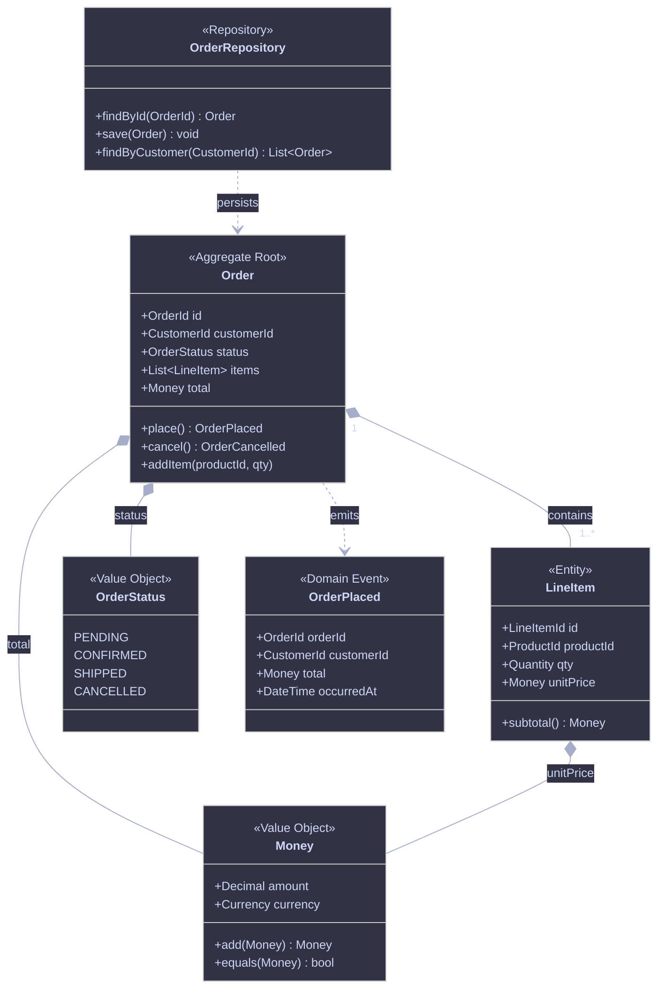
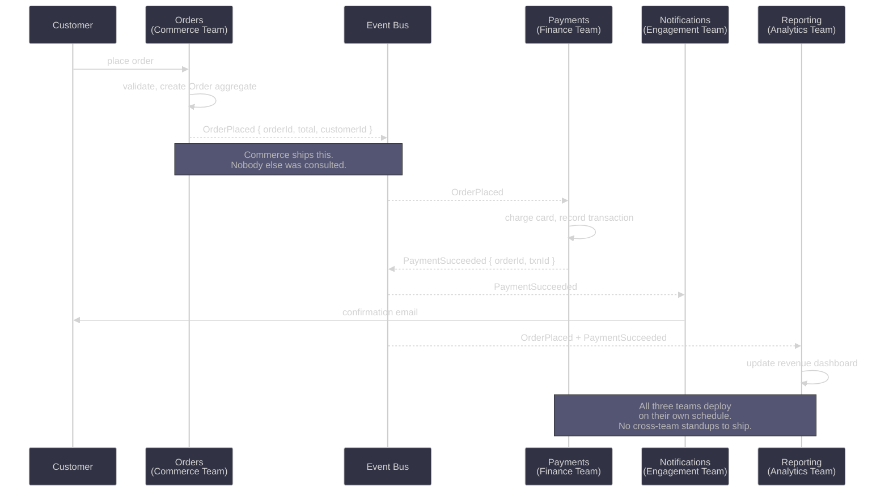
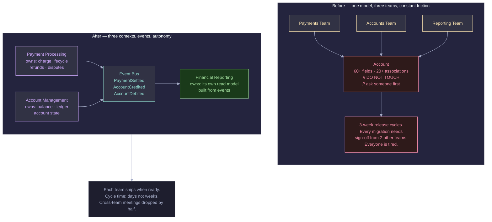

Here's a bug that took three weeks to track down.

The backend team added a `status` column to the `users` table to track onboarding progress, steps 0 to 4. The frontend team read the same field as a boolean: account active or not. The data team exported it weekly and sorted users into cold, warm and hot engagement tiers.

Nobody documented any of this, because nobody thought they needed to. The column was called `status`, after all.

Then a badly timed migration broke the frontend and corrupted the analytics pipeline, and the on-call engineer spent three weeks digging through git history to work out why.

Collaboration failures are like that. They hide in the gap between what you think a word means and what your colleague thinks it means, and you usually find them during a production incident at 2am.

---

## It's not a people problem. It's a structure problem.

Most managers read this as a communication failure and reach for process: more standups, mandatory documentation, a new Confluence page that everyone writes once and nobody reads again.

I've seen this at startups, mid-sized companies and big enterprises. Agile ceremonies don't fix it. Retrospectives surface it but don't solve it. That's because it isn't really a people or process problem. It's a structural one.

When teams don't share a model of the domain they work in, every handoff is a translation, and nobody realises they're translating. People assume they speak the same language because they use the same words. They don't.

This is what Domain-Driven Design (DDD) addresses. Eric Evans introduced the term in 2003 and the core idea is deceptively simple: the structure of your software should reflect the structure of the business. Not the structure of your database. Not the structure of your org chart from three reorgs ago. The actual domain, the problem space your business exists to solve.

What I find most useful about DDD is how seriously it takes language.

---

## Shared language is an architecture decision

DDD calls this *Ubiquitous Language*. Engineers, product managers, designers and analysts all use the same vocabulary for the domain. No "we call it an order but finance calls it a transaction." One term, one definition, used everywhere.

That includes the code.

When engineers name classes and methods with the business's own words, a product manager can read the code and recognise the concepts, and an engineer can read a spec without translating it. A whole category of bugs, the ones caused by misunderstood requirements, gets much rarer.

It's harder than it sounds. You have to resist renaming things to what *you* find cleaner. If the business says "Order", the class is `Order`, not `PurchaseRecord`, `TxnEntity` or `SaleModel`.

Teams that do this tend to move faster, because what they decided and what they built stay close together.

---

## Big models get out of hand

Almost every growing company falls into this one.

It starts simply. You have a `Customer` with a name, an email and maybe a billing address, and everyone uses it. Then Sales needs to add a preferred rep. Support needs to track open ticket counts. Finance needs invoice history and credit limits. Marketing wants engagement scores. Twelve months later, `Customer` has 60 fields, a confusing network of relationships, and a comment at the top of the file that says `// DO NOT TOUCH - ask @someone before changing anything`.

Nobody owns it, which means everybody does, which in practice means nobody does.

DDD's answer is the **Bounded Context**: an explicit, named boundary inside which a model applies. In Sales, `Customer` means one thing. In Finance it means something else. Both are valid, and neither leaks into the other.

The only thing they share is a stable identifier (a `CustomerID`) that lets them talk about the same real-world entity without needing to agree on every attribute.

It's also a way of assigning ownership. Bounded Contexts map to teams: Sales belongs to Commerce and Finance belongs to Finance. When something breaks in Finance's `Customer` model, you know whose phone to call, and the Commerce team doesn't need to be involved.

---

## Draw the context map

Most teams already have several contexts, whether they know it or not. The dependencies between teams exist, but nobody has written them down. You find out when something changes upstream and breaks three things downstream that nobody knew were connected.

A **Context Map** fixes that. It's a diagram of your contexts and how they relate. Hand-drawn is fine.

The useful part is the relationship labels. DDD has names for the ways contexts relate:

An **Anti-Corruption Layer** is what you build when you have to integrate with a system that has a messy model you don't control. You write a translation layer that converts their concepts into yours, so their chaos doesn't leak into your clean domain. If you've ever written an adapter for a third-party API with bizarre field names and six levels of nesting, you've built an ACL without knowing what to call it.

A **Shared Kernel** means two teams own a small, explicitly agreed piece of the model together. Changes require coordination. Use this sparingly, shared ownership is shared risk.

A **Customer/Supplier** relationship is refreshingly honest. The downstream team (customer) tells the upstream team (supplier) what they need, and the upstream team tries to deliver it. Not always with perfect success, but at least it's named.

Names help because they make conversations more precise. "We have a dependency" becomes "we're downstream of Payments in a Customer/Supplier relationship, and they keep breaking our integration." That's a more productive conversation.

---

## Your architecture mirrors your teams

Conway's Law sounds cynical but holds up: an organisation that designs a system will produce a design that copies its own communication structure.

Teams that don't talk produce systems with unclear interfaces between them. Teams split by technology layer (frontend, backend, database) produce a layered monolith, even if nobody planned it.

DDD's suggestion is to use this deliberately. If you want an architecture organised by business domain, organise the teams by business domain first and the architecture tends to follow. It's often called the "Inverse Conway Maneuver", and in my experience it works better than architectural governance.

---

## Tactical patterns

The strategic side (contexts, maps, language) gets most of the attention, but DDD also has tactical patterns that give engineers a shared vocabulary for the code. You use them once the boundaries are drawn.

An **Aggregate** is a cluster of objects that change together, with a single root that controls access. In the diagram above, `Order` is the root. You never reach into a `LineItem` directly from outside, you always go through `Order`. That makes the consistency boundary explicit.

**Value Objects** are immutable. `Money` has no identity, a $10 value object is interchangeable with any other $10 value object of the same currency. It prevents a whole class of bugs, such as changing a price on one object and accidentally affecting another.

**Domain Events** record facts. `OrderPlaced` means something happened, past tense, immutable, true. It's not a command. It's not a request. Something happened and we're recording it. This distinction matters for how teams interact with each other.

---

## Domain events let teams stay out of each other's way

Understanding Domain Events properly changed how I think about team autonomy. When a context publishes an event, it announces a fact without knowing or caring who's listening. Other contexts react. There's no direct coupling and no "we need the Notifications team's endpoint before we can ship."

Notice what's missing. Commerce never calls Notifications directly, Engagement doesn't wait for Finance to expose an API, and Analytics doesn't ask Commerce for order data. Everyone reacts to shared facts, so everyone can ship without scheduling around everyone else.

For me this is the real benefit for collaboration. It works as an agreement between teams: we promise to publish accurate events, and you do what you like with them.

---

## An example

Imagine a fintech startup with three teams sharing a Rails monolith. Payments, Accounts and Reporting all work in one codebase and all write to the same `Account` model, which has collected 60-odd fields over 18 months. Nobody wants to touch it.

Every release needs all three teams. A Reporting query nobody remembers fails silently when Payments changes an account state transition. Any migration needs sign-off from two other teams, and releases happen every three weeks. Everyone is worn out.

Now suppose they run an Event Storming workshop: three hours, lots of sticky notes, and some heated arguments about what "account" means. They come out with three named contexts, a rough event schema, and the realisation that Reporting never needed the `Account` model at all. It only needed events.

Some months later they can ship much more often. The bloated `Account` model still exists inside the Accounts context, but cleaning it up is that team's job, on their own timeline. Payments has a lean model, and Reporting has a read model built from events.

---

## You Don't Have to Do All of This at Once

DDD has a reputation for being heavyweight because people treat it as all or nothing. They see Evans' 560-page book and either implement everything or none of it. Neither works well.

```mermaid
%%{init: {'theme': 'dark', 'themeVariables': {'primaryColor': '#313244', 'primaryTextColor': '#CDD6F4', 'primaryBorderColor': '#45475A', 'lineColor': '#A6ADC8', 'background': '#1E1E2E', 'mainBkg': '#313244', 'clusterBkg': '#24243E', 'fontFamily': 'JetBrains Mono, monospace', 'fontSize': '13px'}}}%%
flowchart LR
    classDef yellow fill:#313244,stroke:#F9E2AF,color:#F9E2AF
    classDef blue   fill:#313244,stroke:#89B4FA,color:#89B4FA
    classDef green  fill:#1A3A1A,stroke:#A6E3A1,color:#A6E3A1
    classDef red    fill:#2E1A1A,stroke:#F38BA8,color:#F38BA8
    classDef mauve  fill:#313244,stroke:#CBA6F7,color:#CBA6F7
    classDef teal   fill:#313244,stroke:#94E2D5,color:#94E2D5
    classDef dim    fill:#1E1E2E,stroke:#45475A,color:#A6ADC8

    S1["1. Event Storming<br/>──────────<br/>3 hours, sticky notes,<br/>domain experts in the room.<br/>Surfaces what you don't know."]:::yellow

    S2["2. Shared Glossary<br/>──────────<br/>Pick your 5 most<br/>misused terms.<br/>Write definitions. Get sign-off."]:::blue

    S3["3. Context Map<br/>──────────<br/>Draw the boundaries<br/>that already exist<br/>but aren't documented."]:::mauve

    S4["4. Tactical Patterns<br/>──────────<br/>Value Objects for money.<br/>Domain Events for<br/>cross-team handoffs."]:::teal

    S5["5. Protect Boundaries<br/>──────────<br/>Anti-Corruption Layers<br/>for legacy systems and<br/>third-party APIs."]:::green

    S1 --> S2 --> S3 --> S4 --> S5
```

Begin with what gives the most value for the least disruption, which for most teams is steps 1 and 2. Run an Event Storming session with domain experts and engineers in one room, mapping what actually happens in the business. Then write a glossary for the five terms that cause the most confusion in your standups.

Neither step touches your architecture, and both improve communication straight away. Add the context boundaries, tactical patterns and event-driven integration later, when they make sense.

One thing to avoid is picking up DDD vocabulary without the discipline. If half the team says Order and the other half still says Transaction, you haven't adopted Ubiquitous Language. You've added jargon. The shared vocabulary is the one part I wouldn't do halfway.

---

## What it really gives you

The main benefit of DDD, I think, isn't better architecture. It's that teams trust each other faster.

With explicit boundaries, teams can rely on each other to stay inside them. With events as the handoff, no team can break another's internals. With a shared language, you stop spending half a meeting discovering that you've been talking past each other.

That is what makes collaboration work at scale. It comes from structures that make the right thing easy and the wrong thing obvious, not from more process or more documentation. How you model the domain shapes how well your teams work together. Get the model right and a lot of friction goes away. Get it wrong and no amount of Agile ceremony will save you.

---

If you want to try it, book a two-hour Event Storming session with your team. Bring someone from product, someone from the business side, and your senior engineers. You'll probably be surprised by how much people disagree on terms you all thought you shared.

---

**Tags:** Domain-Driven Design · Software Architecture · Team Collaboration · Engineering Culture · Microservices
