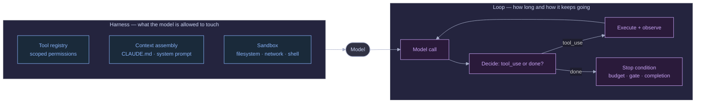
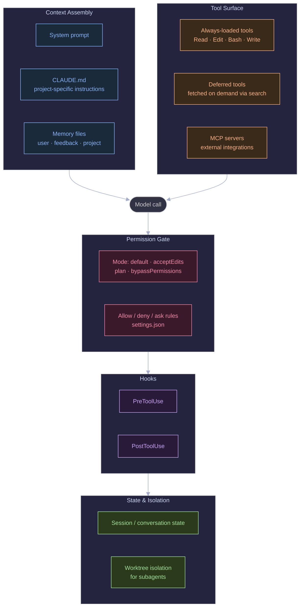
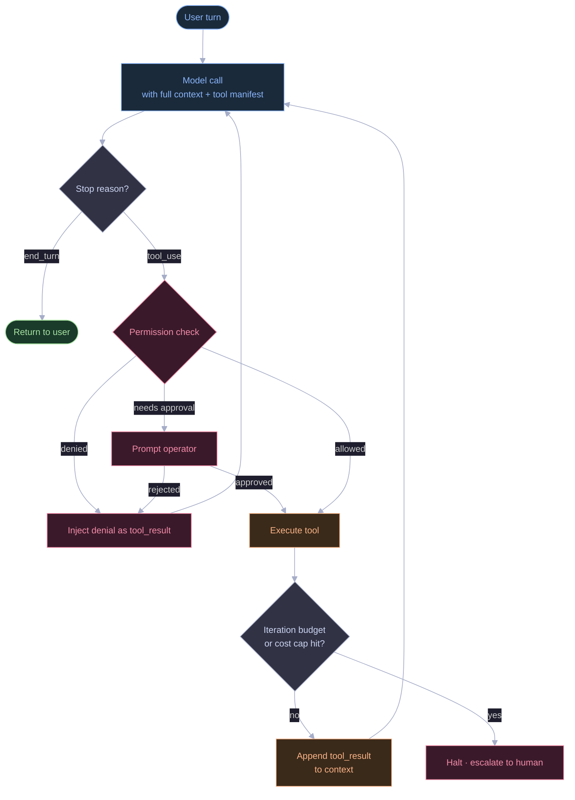
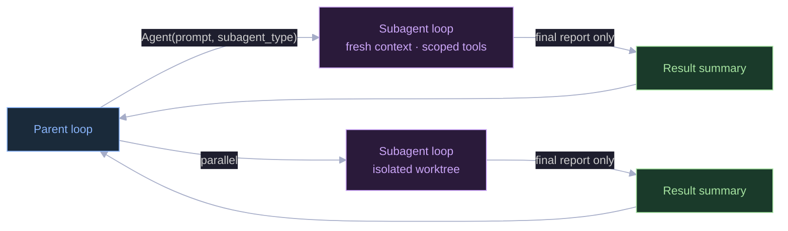

First, what is an **AI agent**? The term gets thrown around loosely. It's a language model (an LLM, the kind of AI behind ChatGPT or Claude) that does more than answer a question once. It can take actions such as reading a file, running a command or searching the web, look at what happened, and decide what to do next, in a loop, until the task is done. A chatbot takes one input and gives one output. An agent can keep acting, unsupervised, for as long as it takes.

That's what makes agents useful, and also what makes them risky. **Prompt engineering** is about wording your instructions so a model gives a good answer in a single response. That's necessary, but it isn't enough once the model is acting on its own, reading its own results, deciding what to do next and deciding when to stop. At that point a second discipline appears. The question changes from "what do I say to the model?" to "what do I build *around* it?"

I call the two halves **harness engineering** and **loop engineering**. People often lump both together as "the agent," but they're different things.

- The **harness** is everything the model is *allowed to do*, which tools it can call, what files it can touch, what commands are off-limits, how much context it sees before it even starts.
- The **loop** is the *control flow* that keeps calling the model, checking what it wants to do, letting it (or not), feeding the result back, and deciding when to stop.

Get the harness wrong and a capable model can do dangerous or useless things simply because nobody told it not to. Get the loop wrong and a well-behaved model can still run forever, burn through your budget, or drift off the original task because nothing was watching for it.

This post explains both from first principles, then walks through one example: an agent that auto-fixes failing tests in a pull request. I'll use Claude Code (permission modes, hooks, subagents, on-demand tool loading and `CLAUDE.md` instructions) as the running reference, since I use it every day.

---

## A few terms

If you've built with LLM APIs before, skip this. If not, these five terms come up a lot:

- **Context window**, the total amount of text (measured in *tokens*, roughly word-fragments) a model can "see" at once, including its instructions, the conversation so far, and anything it just read. It's finite, usually a few hundred thousand tokens, and everything you put in it costs money and pushes out room for something else.
- **System prompt**, a block of instructions given to the model before the conversation starts, setting its role, rules, and boundaries. The user never sees it directly; it shapes how the model behaves throughout.
- **Tool call / tool use**, when a model, instead of just replying with text, asks to run a specific action, "call the `Bash` tool with this command", and waits for the result before continuing. This is the mechanism that turns a chatbot into an agent.
- **MCP (Model Context Protocol)**, a standard way to plug external systems (Slack, a database, Google Drive) into an agent as tools, without writing custom integration code for each one.
- **Sandbox**, a restricted environment (limited filesystem access, no network, a disposable container) that limits what a tool call can actually affect, even if the model asks for something dangerous.


## Two failure modes

The easiest way to see why they're separate is to look at what breaks when you skip each one.

**Skip the harness** and the model has no boundaries. It can call any tool with any argument, read files outside the project, run destructive shell commands or leak sensitive output. It isn't malicious. Nothing told it not to. I call this a **scope failure**: it did something it should never have been allowed to try.

**Skip the loop design** and the model has boundaries but no brakes. It re-reads the same file five times, retries a failing action endlessly, or keeps going "one more turn" until the conversation has been summarised so many times that it forgets what it was asked to do. I call this a **termination failure**: each action was allowed, but nothing made it stop.



The **harness** (left) is set up once, before anything runs, and defines the walls. The **loop** (right) is what happens turn after turn: call the model, see whether it wants a tool, run it if allowed, and go round again until something says stop. Most prompt engineering advice is about the small "Model" circle in the middle. In my experience, most of the reliability problems in real agent systems are in everything else in the picture.

---

## What a harness is made of

The harness is everything that's true about the model's environment before it generates a single word. It's like onboarding a contractor: before they touch anything, you've decided which systems they can log into, which files they can edit and who has to approve what. The harness is that setup, written down and enforced in code. For a coding agent like Claude Code it looks roughly like this:



Five boxes, five jobs:

- **Context Assembly**, what information the model gets to see before it starts working: its instructions, any project-specific rules, anything remembered from before.
- **Tool Surface**, the full list of actions the model is even capable of requesting. If a tool isn't in this list, the model can't call it, period, this is the first and strongest form of control.
- **Permission Gate**, for tools that *are* available, whether a specific call is allowed to actually run, or needs a human to approve it first.
- **Hooks**, small pieces of code that run automatically before or after a tool call, regardless of what the model "intended."
- **State & Isolation**, what gets remembered between turns, and what stays walled off between separate agents working at the same time.

Three of these deserve a closer look, because they're the parts people tend to skip when building their own harness.

### Deferred tool loading

Every tool comes with a description (its "schema"): its name, its arguments and what it does. The model can only use what's in its context window, so if you describe forty tools in full, you pay for all forty on every turn, whether or not they're used. It's like making a new employee re-read the whole handbook before every task instead of pointing them to the one page they need.

Claude Code handles this by showing the model only tool *names* by default and loading the full description once a tool looks necessary:

```
# What the model sees by default — just names, cheap to include:
CronCreate, CronDelete, WebFetch, SendMessage, ... (names only)

# Only after the model asks for one specifically:
ToolSearch("select:WebFetch") → full parameter schema, now callable
```

This matters more as the tool list grows. MCP makes it easy to add a dozen integrations, and without deferred loading every one of their descriptions sits in every prompt, even when the task has nothing to do with Slack or a database.

### Permission modes

The simplest harness is binary: the model can do anything, or it must ask about everything. The first is reckless and the second is so irritating that people switch it off. Claude Code has a few modes in between: `default` (ask before risky actions), `acceptEdits` (auto-approve file edits, ask about the rest), `plan` (read and research only) and `bypassPermissions` (no asking). It's a dial you set based on how much you trust the agent and how bad a mistake would be. A file edit and a `git push --force` are not the same risk, so they shouldn't need the same approval.

### Hooks

You can tell a model in its instructions not to run destructive commands, and it will usually listen. "Usually" is the problem. A **hook** is a small script that runs before a tool executes (a `PreToolUse` hook) and can block the call whatever the model decided. That matters wherever "usually" isn't good enough: compliance requirements, sensitive repositories, audit trails. A prompt instruction is a request. A hook is a rule the code enforces whether the model agrees or not.

---

## What a loop is made of

If the harness is the walls, the loop is what happens inside them: call the model, see what it wants to do, act on it if allowed, feed the result back, and repeat until there's nothing left to do or a limit is hit.



In words: the model is called and replies with a `stop_reason`, a label saying why it stopped generating. If it's `end_turn`, the model has a final answer and you return it. If it's `tool_use`, the model wants to run something, and that's when the permission check from the harness is consulted. If denied, the model is told so (as a `tool_result`, the standard way to feed an outcome back) and tries something else. If allowed, the tool runs, the result is appended to the conversation, and the loop goes round again, unless a budget or cost limit has been hit, in which case it stops and escalates to a human.

The permission check and the budget check are, to me, the heart of it. The rest is plumbing.

### A minimal loop in code

Production frameworks add a lot of ceremony, but the core is small enough to read in one go:

```python
def run_loop(client, system_prompt, tools, user_message, max_iterations=25):
    # messages is the running conversation — every model reply and every
    # tool result gets appended here, and the whole thing is sent back
    # to the model on the *next* call so it has full context of what happened.
    messages = [{"role": "user", "content": user_message}]

    for iteration in range(max_iterations):
        # One call to the model. It sees the system prompt (its instructions),
        # the tools it's allowed to request, and the conversation so far.
        response = client.messages.create(
            model="claude-sonnet-5",
            system=system_prompt,
            tools=tools,
            messages=messages,
        )
        messages.append({"role": "assistant", "content": response.content})

        if response.stop_reason != "tool_use":
            return response  # model gave a final answer — end_turn — we're done

        # The model wants to run one or more tools. Each one shows up as a
        # separate "tool_use" block inside response.content.
        tool_results = []
        for block in response.content:
            if block.type != "tool_use":
                continue

            decision = check_permission(block.name, block.input)  # harness boundary
            if decision == "denied":
                result = f"Denied: {block.name} is not permitted in this context"
            else:
                result = execute_tool(block.name, block.input)    # harness boundary

            # tool_result tells the model what happened — success, failure,
            # or a denial reason — so it can decide what to do on the next turn.
            tool_results.append({
                "type": "tool_result",
                "tool_use_id": block.id,
                "content": result,
            })

        messages.append({"role": "user", "content": tool_results})

    # We reached the iteration cap without the model ever giving a final
    # answer — that's the loop's safety valve, not an edge case to ignore.
    raise IterationBudgetExceeded(f"No terminal response after {max_iterations} turns")
```

Note what's missing: retry logic, summarising old messages, cost tracking and spawning other agents. A production harness needs all of those, but each hooks into this loop at one narrow point: the `check_permission` call, the `execute_tool` call or the iteration limit. Don't build them before the basic loop works. A simple loop with a hardcoded cap and a basic permission check that terminates correctly beats an elaborate one that doesn't.

---

## Subagents

Once the basic loop works, the next question is what to do when a task is too big for one context window, or should be kept apart from the main conversation. A code reviewer shouldn't see the author's back-and-forth, and a research task shouldn't fill the main thread with dozens of search results.

Claude Code, like most serious multi-agent systems, answers by doing the same thing again at a smaller scale. A **subagent** is a second, independent harness-plus-loop, with its own tools, permission checks, iteration budget and conversation history, which the parent agent invokes like any other tool.



Two details matter here. First, **fresh context**: the subagent starts with no memory of the parent's conversation, only what it's explicitly given. Second, the parent gets back only the subagent's **final report**, not its turn-by-turn transcript.

That choice does real work. **Worktree isolation**, giving each subagent its own copy of the files, stops parallel agents overwriting each other's changes. Hiding the intermediate steps keeps the parent's context window from filling up. It's the same idea I used in the pipeline from my [earlier post](/blog/2026/06/06/sdlc-factory-autonomous-multi-agent-pipeline/): each stage received only the finished output of the previous one, never its raw conversation. In practice harness and loop engineering aren't really separable. They're one design decision seen from two sides.

---

## Where this breaks in practice

**Unbounded loops that look like thoroughness.** Given a broad task and no cap, a model will happily read every file in a large project "to be thorough." Wanting more context isn't the bug. Nothing stopping it is. An iteration cap is the loop's real safety valve, not an afterthought, and it should scale with risk: a read-only subagent can reasonably get more turns than one that can delete or overwrite things.

**Tool schema bloat.** Each MCP integration adds tool descriptions to the context. Past a point, a new tool costs more in context than it adds in capability, and it raises the odds of the model picking the wrong tool among many similar ones. On-demand loading is the fix, rather than simply having fewer tools, since you often do need the capability, just not paid for on every turn.

**Permission checks that only look at the tool name.** `Bash` isn't one risk level. `ls` and `rm -rf` are both "the Bash tool." A harness that checks only which tool is called, and not what it's asked to do, ends up too permissive (allow all `Bash`) or too annoying (ask about every call). The permission layer has to look at the arguments.

**Losing the "why" in compaction.** When a long conversation outgrows the context window, older parts are summarised to make room. This is **compaction**. It's easy for the summary to keep *what* happened (files touched, commands run) and lose *why* (the reasoning that ruled out another approach earlier). A summary that's just an action log makes the loop retry things it already rejected. Good compaction keeps the reasoning.

**Confusing "the model refused" with "the harness blocked it."** They can look identical in a transcript but need opposite fixes. If the model is declining something reasonable, that's a prompt problem. If a hook or permission rule is silently blocking something it shouldn't, that's a harness bug, and it's easy to blame the model when the fix is in your `PreToolUse` hook.

---

## A worked example: a CI auto-fix agent

Here's one concrete scenario, the kind of agent teams reach for early: **watch a pull request's failing tests (CI, continuous integration) and have the agent push a fix.**

### What the naive version does

The naive build takes twenty minutes. Give the model three tools: `Bash` (run shell commands), `Edit` (modify a file) and `Write` (create a file). The system prompt says *"Fix the failing tests in this PR. Don't touch unrelated code."* Wrap it in a loop that runs until the model says it's done.

Here's what I'd expect on the first real pull request, as opposed to a clean demo:

1. **It runs forever.** One failing test is *flaky*, failing intermittently for reasons unrelated to the code. The model "fixes" it, the flake comes back, the model reverts its fix, the test passes by chance, the model declares victory, and the flake returns on the next run. Forty turns later it's still flipping between two versions of one function.
2. **It edits files outside the PR.** Nothing *enforces* "don't touch unrelated code." The instruction works only if the model happens to follow it. It spots an unrelated warning two files over and cleans it up while it's there, and a two-line fix now touches eleven files.
3. **It runs a destructive command.** To get a clean starting point, it runs `git checkout .`, which discards all uncommitted changes, including a colleague's unsaved work in the same workspace.

None of this is mysterious misbehaviour. Each is a specific missing control, and each maps to something earlier in this post:

| Failure | Missing control | Which side |
|---|---|---|
| Runs forever, oscillates | No stop condition beyond "the model says it's done" | Loop |
| Edits unrelated files | No check on what `Edit`/`Write` is actually touching | Harness |
| Destructive `git` command | No check on what the `Bash` command actually says | Harness |

### The fixes

None of this needs a new framework. The permission check and the stop condition just have to inspect what's actually happening instead of trusting the prompt:

- **Restrict `Edit`/`Write` to the files the PR already changes.** Anything else is denied before it runs.
- **Check the actual `Bash` command text.** Match every command against a deny-list of destructive patterns such as `rm -rf`, `git push --force`, `git checkout .` and `git reset --hard`.
- **Replace "the model says it's done" with a progress signal.** Track how many tests fail after each attempt. If the number hasn't dropped over the last few tries, the loop is stuck, not thorough. Stop and hand it to a human.

### Building it

Both checks are plain deterministic code, not another model call, so they're cheap enough to run on every tool call.

**The scope check** plugs into the same `check_permission` step as the minimal loop. It runs before a tool executes, so a bad call never happens:

```python
import re

# Only files this specific PR already modifies — computed once, up front,
# from the PR's diff. Nothing outside this list is in scope.
ALLOWED_PATHS = get_changed_files(pr_diff)

# Regex patterns matched against the literal command string before it runs.
DANGEROUS_COMMANDS = [
    r"rm\s+-rf",              # recursive, forced delete
    r"git\s+push\s+.*--force", # overwrites remote history
    r"git\s+checkout\s+\.",    # discards all local uncommitted changes
    r"git\s+reset\s+--hard",   # discards all local changes and history
]

def check_permission(tool_name, tool_input):
    if tool_name in ("Edit", "Write"):
        path = tool_input["file_path"]
        if path not in ALLOWED_PATHS:
            return "denied", f"{path} is outside this PR's changed-file scope"

    if tool_name == "Bash":
        command = tool_input["command"]
        if any(re.search(pattern, command) for pattern in DANGEROUS_COMMANDS):
            return "denied", f"blocked destructive command: {command}"

    return "allowed", None
```

**The progress check** lives in the loop itself and runs after each tool result. The only new state is `failure_counts`, a list of how many tests failed after each attempt:

```python
def run_ci_fix_loop(client, system_prompt, tools, pr_context, max_iterations=15):
    messages = [{"role": "user", "content": pr_context}]
    failure_counts = []

    for iteration in range(max_iterations):
        response = client.messages.create(
            model="claude-sonnet-5", system=system_prompt, tools=tools, messages=messages
        )
        messages.append({"role": "assistant", "content": response.content})

        if response.stop_reason != "tool_use":
            return response

        tool_results = []
        for block in response.content:
            if block.type != "tool_use":
                continue

            decision, reason = check_permission(block.name, block.input)
            if decision == "denied":
                result = f"Denied: {reason}"
            else:
                result = execute_tool(block.name, block.input)
                # Every time the agent runs the test suite, record how many
                # tests are still failing — this is the progress signal.
                if block.name == "Bash" and "pytest" in block.input.get("command", ""):
                    failure_counts.append(count_failures(result))

            tool_results.append({"type": "tool_result", "tool_use_id": block.id, "content": result})

        messages.append({"role": "user", "content": tool_results})

        # If the last 3 test runs show the exact same failure count,
        # the agent isn't making progress — it's stuck, not being thorough.
        if len(failure_counts) >= 3 and len(set(failure_counts[-3:])) == 1:
            escalate_to_human(reason="no progress in last 3 test runs", transcript=messages)
            return None

    escalate_to_human(reason="iteration budget exceeded", transcript=messages)
```

**A backup for destructive commands** lives outside the Python entirely, as a **hook**, so a bug in `check_permission` doesn't remove the protection:

```json
// .claude/settings.json — enforced regardless of what the loop code does
{
  "hooks": {
    "PreToolUse": [
      {
        "matcher": "Bash",
        "hooks": [{ "type": "command", "command": "scripts/block-destructive-git.sh" }]
      }
    ]
  }
}
```

That's defence in depth rather than duplication. The two checks are separate pieces of code, so a mistake in one leaves the other intact.

### What changes

On the flaky-test PR, the progress check fires after three flat test runs instead of forty turns of back-and-forth. On the "clean up this unrelated file" case, the `Edit` is denied before it touches disk and the model is told why, so it adjusts. On `git checkout .`, the command is blocked twice, once by the argument check and once by the hook, and there's a record of what was attempted.

Same task, same model, same prompt. The only difference is that the harness and loop no longer assume the prompt alone will keep the model in line.

---

## Closing thoughts

Prompt engineering tunes a single response. Harness and loop engineering are about a system that takes many actions on its own. In theory they're separate: the harness is what's allowed, the loop is how long it runs and when it stops. In practice they're tightly linked, because the things you care about in production (bounded cost, bounded blast radius, loud failures instead of silent ones, being able to recover from a mistake) are all enforced where the two meet.

If you build on an existing harness like Claude Code or the Claude Agent SDK, the work doesn't disappear. It moves. You won't write `check_permission` by hand, but you will write `settings.json` rules, hooks and `CLAUDE.md` scope. You won't write the iteration cap, but you will decide subagent boundaries and what information crosses them.

If you're building your first agent, start with the permission boundary and the stop condition, before the prompt. Everything else is easier to fix once those two are solid.
