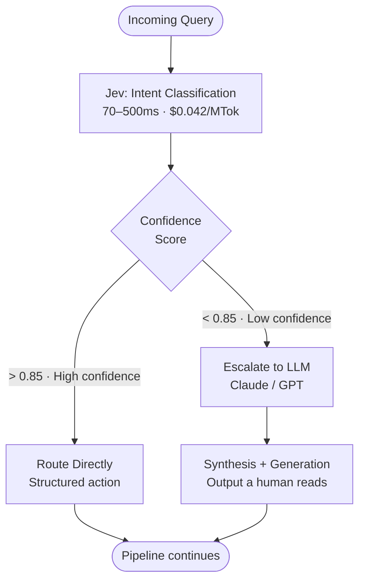
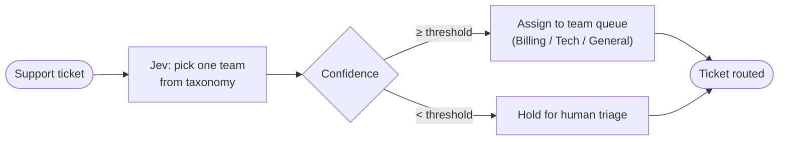
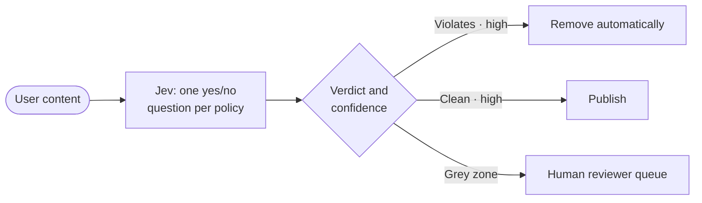
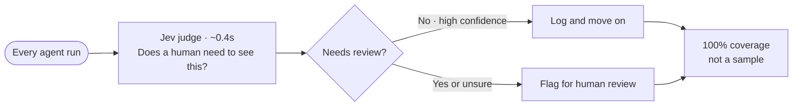
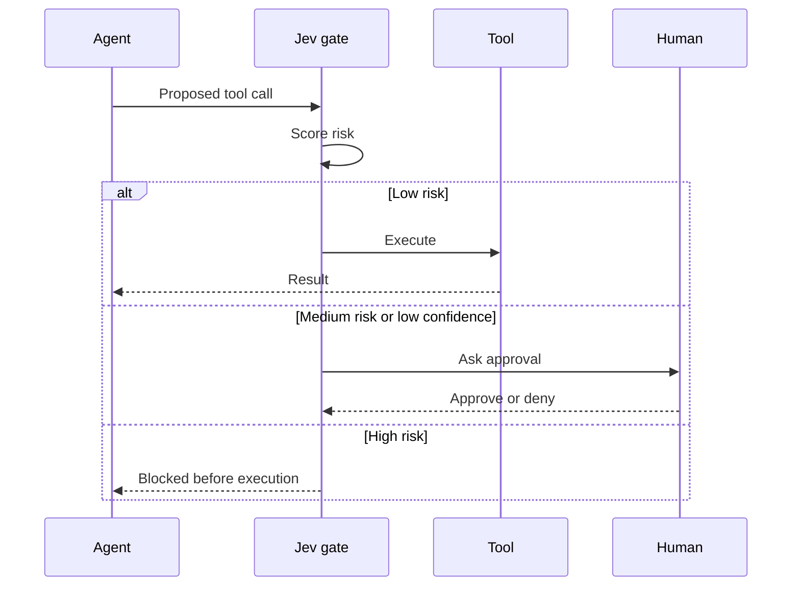
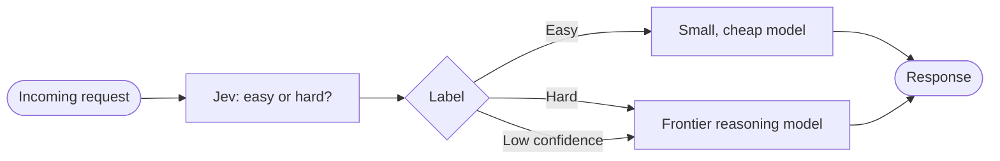
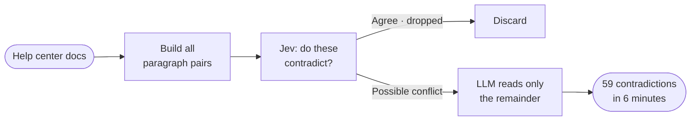
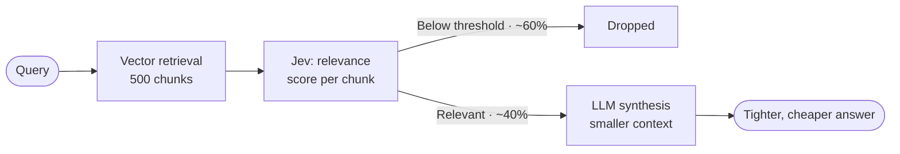
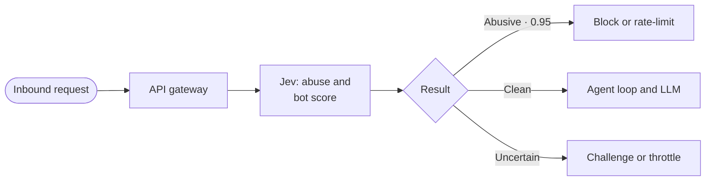
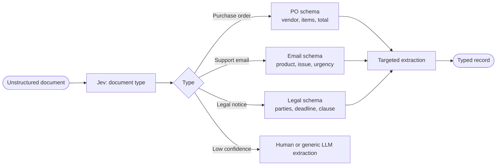

Most enterprise agent pipelines start from the same assumption: the AI layer is an LLM, every call goes through it, and the only open question is which one. I built a production pipeline on that assumption, and after running it for a while I started to doubt it.

I profiled the calls and about 80% of the AI work was structured decision-making: classify this intent, score this document for relevance, pull these fields out of some messy input. No human ever read those outputs. They went straight into the next system. So I was paying frontier prices and waiting on LLM latency for work that didn't need generation at all. Every so often the model also invented a field that wasn't in the input, which is what you get when nothing in the architecture stops it.

That made me look at Jev, released in September 2026 by TypeSafe AI, founded by Diogo Almeida (formerly OpenAI).

## What System One Models Actually Are

LLMs are trained with RLHF. The optimization target is outputs human raters prefer, which makes them excellent at generation and structurally overconfident. Uncertain answers score poorly with human raters even when uncertainty is the accurate state. The output is always a string. Your code parses it, validates it, and lives with the fact that there's always a path where the model produces well-formatted nonsense.

Jev uses RLCD, Reinforcement Learning for Calibrated Decisions. You define the output schema in advance. The model selects from that space and returns a typed value with a calibrated confidence score. There's no generative step. The model cannot produce an output that violates the schema because the schema is the entire output space. TypeSafe describes it as "a frontier-intelligence function call: unstructured state in, typed probabilistic decisions out."

The calibration is as important as the typing. An LLM prompted to express confidence tends to express consistent confidence, not accurate confidence. Calibrated means when Jev reports 90% confidence, it's right 90% of the time statistically across those calls. That becomes a real architectural control surface: you set the threshold for autonomous action versus escalation, and the threshold is meaningful.

## What This Looks Like in Code

Real agent pipelines run two kinds of work through the same model: decisions at the edges and synthesis at the core. Jev takes the decisions, and an LLM stays on anything a person will read. The confidence threshold ties the two together. With an LLM, "escalate if unsure" means prompt engineering and hoping the model reports its own uncertainty honestly. With Jev, it's a numeric cutoff on a calibrated score, so you can set it and test it.



Here's a routing step from a RAG intake pipeline. The before version uses an LLM to classify whether an incoming query needs retrieval:

```python
# Before: LLM call, parse string, hope it says yes or no
response = claude.messages.create(
    model="claude-sonnet-5-5",
    messages=[{"role": "user", "content": f"Does this query need retrieval? {query}"}]
)
needs_retrieval = "yes" in response.content[0].text.lower()
```

The failure here is easy to miss because the output looks fine. The model might say "Yes, retrieval is needed" or "Retrieval would be appropriate here" or add caveats that break the parse. The Jev version:

```python
# After: Jev typed decision with calibrated confidence
result = jev.decide(
    input=query,
    schema={
        "needs_retrieval": {"type": "bool"},
        "category": {"type": "enum", "values": ["billing", "technical", "general"]}
    }
)
if result.confidence > 0.85:
    route_autonomously(result.needs_retrieval, result.category)
else:
    escalate_to_llm(query)
```

It's cleaner, but that's the smaller benefit. A bad schema fails when you define it instead of quietly misbehaving in production, and the confidence check is a real number, not a string you hoped to parse.

## The Cost and Latency Gap

Frontier LLMs run $0.20 to $10 per million input tokens with response times of 3 to 329 seconds. Jev is $0.042 per million tokens, responds in 70 to 500ms, and output tokens are free.

For classification, routing, and structured extraction workloads, that's roughly 100x cheaper and 40 to 200x faster. TypeSafe published results from Jack and Jill, a hiring platform: they replaced an LLM-based candidate screening pipeline with Jev and got 88% cost reduction, 2x throughput, and 10 days from test to production.

## Workflows Where Jev Changes the Math

Each workflow below follows the same layout: what it does, the flow, then the code. The code uses the same `jev.decide` shape as the routing example above. I'm showing the shape of each integration, so check the exact calls against TypeSafe's docs before you copy anything.

### Six patterns from TypeSafe

#### 1. Ticket routing

Give Jev a support ticket and your team list, and it picks one team and tells you how sure it is. If it isn't sure enough, the ticket waits for a person. On a 77-intent test this came out about 84x cheaper than routing through Opus 5.5. The bigger win for me is the confidence score. When an LLM answers "Billing team", you have no idea whether that was a firm call or a coin flip.



```python
TEAMS = ["billing", "technical", "account", "general"]

def route_ticket(ticket):
    r = jev.decide(
        input=ticket.body,
        schema={"team": {"type": "enum", "values": TEAMS}},
    )
    if r.confidence >= 0.85:
        queues[r.team].put(ticket)
    else:
        triage_queue.put(ticket, hint=r.team)  # a human still sees the best guess
```

#### 2. Content moderation

Ask one yes/no question per policy, like "is this offensive?". Jev acts when it's confident and sends the grey area to a person. There's no string parsing and no made-up explanation of why something crosses the line. TypeSafe reports the best moderation score of the six models in their published test.



```python
POLICIES = {
    "harassment": "Is this content harassing toward a person or group?",
    "spam": "Is this content unsolicited promotion or spam?",
}

def moderate(post):
    for name, question in POLICIES.items():
        r = jev.decide(
            input=post.text,
            schema={"violates": {"type": "bool", "question": question}},
        )
        if r.violates and r.confidence > 0.9:
            return remove(post, reason=name)
        if r.confidence <= 0.9:
            return review_queue.put(post, policy=name)
    return publish(post)
```

#### 3. AI judges

Most teams sample a few agent runs and review those by hand. Instead, put Jev on every run and ask "does a human need to see this?" A check takes about 0.4s, against roughly 10s for an LLM judge, so you can afford to look at all of them rather than a sample. For anything where a miss is costly, that coverage matters more than the cost savings.



```python
def judge_run(run):
    r = jev.decide(
        input=run.transcript,
        schema={"needs_human": {"type": "bool"}},
    )
    # Unsure counts as "yes". It's cheaper to over-flag than to miss one.
    if r.needs_human or r.confidence < 0.8:
        review_queue.put(run)
    metrics.incr("runs_judged")
```

#### 4. Agent safety gates

Put Jev between the agent and its tools. Before any tool call runs, Jev scores it for risk, and the risky ones are stopped. LangChain's harness already supports this as a pluggable interceptor, so you don't have to build the plumbing yourself.



```python
def guarded_call(tool, args):
    r = jev.decide(
        input=f"{tool.name}({args})",
        schema={"risk": {"type": "enum", "values": ["low", "medium", "high"]}},
    )
    if r.risk == "high" and r.confidence > 0.8:
        raise ToolBlocked(f"{tool.name} blocked by safety gate")
    if r.risk != "low" or r.confidence < 0.8:
        if not ask_human_approval(tool, args):
            raise ToolBlocked(f"{tool.name} denied by reviewer")
    return tool.run(**args)
```

#### 5. Model routing

Before a frontier model call, Jev labels the request easy or hard. Easy ones go to a smaller, cheaper model, and hard ones go to the big one. That way you only pay reasoning-model prices when the problem needs reasoning. If Jev isn't sure, I send the request to the big model, because a bad answer costs more than the price difference.



```python
def answer(request):
    r = jev.decide(
        input=request.text,
        schema={"difficulty": {"type": "enum", "values": ["easy", "hard"]}},
    )
    easy = r.difficulty == "easy" and r.confidence > 0.85
    model = "claude-haiku-5-5" if easy else "claude-opus-5-5"
    return claude.messages.create(model=model, messages=request.messages)
```

#### 6. Docs audit

Pair up every paragraph with every other paragraph and ask "do these contradict?" Jev throws away the pairs that agree, so the LLM only reads what's left. TypeSafe ran this on their own help center and found 59 contradictions in 6 minutes.



```python
from itertools import combinations

def audit(paragraphs):
    suspects = []
    for a, b in combinations(paragraphs, 2):
        r = jev.decide(
            input=f"A: {a}\n\nB: {b}",
            schema={"contradicts": {"type": "bool"}},
        )
        if r.contradicts or r.confidence < 0.8:
            suspects.append((a, b))
    # Only the suspicious pairs ever reach the expensive model
    return [explain_conflict(a, b) for a, b in suspects]
```

### Three more from enterprise pipelines

These follow the same logic, though they aren't from TypeSafe's published list.

#### 7. RAG pre-filtering

Before you hand retrieved chunks to the LLM, have Jev score each one against the query and drop the weak ones. You get a smaller context, a lower bill and usually a tighter answer. On a 500-chunk retrieval, cutting 60% of the low-relevance chunks before synthesis adds up fast.



```python
def answer_with_context(query):
    chunks = vector_store.search(query, k=500)
    keep = []
    for chunk in chunks:
        r = jev.decide(
            input=f"Query: {query}\n\nPassage: {chunk.text}",
            schema={"relevant": {"type": "bool"}},
        )
        if r.relevant and r.confidence > 0.7:
            keep.append(chunk)
    return synthesize(query, keep)  # one LLM call over the survivors
```

#### 8. Abuse and rate-limit scoring

Score inbound requests for bot patterns or abuse before they get anywhere near expensive processing. If Jev says a request is clearly abusive at 0.95 confidence, nobody needs an LLM's opinion on it. This check belongs at the API gateway, not inside the agent loop.



```python
def gateway_middleware(request, next_handler):
    r = jev.decide(
        input=request.summary(),  # headers, rate, payload shape
        schema={"traffic": {"type": "enum", "values": ["clean", "bot", "abusive"]}},
    )
    if r.traffic == "abusive" and r.confidence >= 0.95:
        return Response(status=429)
    if r.traffic != "clean" or r.confidence < 0.8:
        return challenge(request)  # CAPTCHA or throttle
    return next_handler(request)
```

#### 9. Structured extraction routing

If you need to pull fields out of unstructured input, classify the document type first. A purchase order, a support email and a legal notice each need a different extraction schema. The classification step is quick and typed. The extraction step that follows is smaller and more accurate because it already knows what it's reading.



```python
SCHEMAS = {
    "purchase_order": {"vendor": "str", "items": "list", "total": "float"},
    "support_email": {"product": "str", "issue": "str", "urgency": "str"},
    "legal_notice": {"parties": "list", "deadline": "date", "clause": "str"},
}

def extract(doc):
    r = jev.decide(
        input=doc.text,
        schema={"doc_type": {"type": "enum", "values": list(SCHEMAS)}},
    )
    if r.confidence < 0.85:
        return generic_llm_extract(doc)
    return jev.decide(input=doc.text, schema=SCHEMAS[r.doc_type]).fields
```

## The Decision Rule

My rule of thumb: if a person ends up reading the output, use an LLM. If your code acts on the output, try Jev first.

The second bucket is bigger than most people expect. Routing, intent classification, entity extraction, confidence gating and relevance scoring are all decision work, and most pipelines run them at LLM prices simply because an LLM is what everyone reaches for first.

We've spent two years arguing about which LLM vendor to pick. For the decision work inside a real agent pipeline, that's the wrong question. The better one is which kind of model the job needs.
