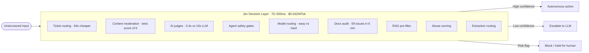

Most enterprise agent pipelines have the same assumption baked in from the start: the AI layer is an LLM, every call goes through it, and the question is just which one. I built a production pipeline with that assumption and ran it long enough to start questioning it.

When I profiled the call breakdown, roughly 80% of the AI work was structured decision-making. Classify this intent. Score this document for relevance. Extract these fields from an unstructured input. None of those outputs were ever read by a human. They fed directly into the next system. I was paying frontier LLM prices and tolerating LLM latency for tasks that didn't need generative capability at all. And occasionally the model would invent a field that wasn't in the input, because nothing in its architecture prevents that.

That's what prompted me to evaluate Jev, released in September 2026 by TypeSafe AI, founded by Diogo Almeida (formerly OpenAI).

## What System One Models Actually Are

LLMs are trained with RLHF. The optimization target is outputs human raters prefer, which makes them excellent at generation and structurally overconfident. Uncertain answers score poorly with human raters even when uncertainty is the accurate state. The output is always a string. Your code parses it, validates it, and lives with the fact that there's always a path where the model produces well-formatted nonsense.

Jev uses RLCD, Reinforcement Learning for Calibrated Decisions. You define the output schema in advance. The model selects from that space and returns a typed value with a calibrated confidence score. There's no generative step. The model cannot produce an output that violates the schema because the schema is the entire output space. TypeSafe describes it as "a frontier-intelligence function call: unstructured state in, typed probabilistic decisions out."

The calibration is as important as the typing. An LLM prompted to express confidence tends to express consistent confidence, not accurate confidence. Calibrated means when Jev reports 90% confidence, it's right 90% of the time statistically across those calls. That becomes a real architectural control surface: you set the threshold for autonomous action versus escalation, and the threshold is meaningful.

## The Two-Stack Architecture

Most real agent pipelines have two kinds of work running through the same model class: decision-making at the edges and synthesis at the core. Separating them is what makes the cost and latency gap meaningful.


The confidence threshold is the key architectural lever. With an LLM, "escalate if unsure" requires prompt engineering and hoping the model accurately signals its own uncertainty. With Jev, it's a numeric cutoff on calibrated output. You set it, it's testable, it's consistent.

## What This Looks Like in Code

Here's a routing step from a RAG intake pipeline. The before version uses an LLM to classify whether an incoming query needs retrieval:

```python
# Before: LLM call, parse string, hope it says yes or no
response = claude.messages.create(
    model="claude-sonnet-5-5",
    messages=[{"role": "user", "content": f"Does this query need retrieval? {query}"}]
)
needs_retrieval = "yes" in response.content[0].text.lower()
```

The failure mode here is invisible: the model parses and responds in ways that look right and aren't. It might say "Yes, retrieval is needed" or "Retrieval would be appropriate here" or add caveats that break the parse. The Jev version:

```python
# After: Jev typed decision with calibrated confidence
result = jev.decide(
    input=query,
    schema={
        "needs_retrieval": {"type": "bool"},
        "category": {"type": "enum", "values": ["billing", "technical", "general"]}
    }
)
if result.confidence > 0.85:
    route_autonomously(result.needs_retrieval, result.category)
else:
    escalate_to_llm(query)
```

The difference isn't just cleaner code. The schema fails loudly at definition time, not silently at runtime. And the confidence gate is a real signal, not a parsed string.

## The Cost and Latency Gap

Frontier LLMs run $0.20 to $10 per million input tokens with response times of 3 to 329 seconds. Jev is $0.042 per million tokens, responds in 70 to 500ms, and output tokens are free.

For classification, routing, and structured extraction workloads, that's roughly 100x cheaper and 40 to 200x faster. TypeSafe published results from Jack and Jill, a hiring platform: they replaced an LLM-based candidate screening pipeline with Jev and got 88% cost reduction, 2x throughput, and 10 days from test to production.

## Workflows Where Jev Changes the Math

TypeSafe published six production patterns. Here they are with the numbers, plus three more that come up repeatedly in enterprise pipelines.

**Ticket routing** — Feed Jev a support ticket and your team taxonomy. It returns one team with a calibrated confidence score. Below threshold, it holds for a human. On a 77-intent test, that came in at roughly 84x cheaper than routing through Opus 5.5. You also get confidence gating the LLM version doesn't give you: an LLM that says "Billing team" has no way to tell you how sure it is.

**Content moderation** — Ask one yes/no question per policy: "is this offensive?" Jev acts at high confidence, routes the grey zone to a person. No string parsing, no hallucinated reasoning about why something crosses the line. TypeSafe reports the best moderation score across six models in their published test.

**AI judges** — Instead of sampling your agent runs for quality review, put Jev on every run asking "does a human need to see this?" At 0.4s per check versus 10s for an LLM judge, you can cover 100% of runs instead of a sample. The coverage gap alone is worth the switch for anything safety-critical.

**Agent safety gates** — Put Jev between your agent and its tools. It scores each tool call for risk before execution. High-risk calls get blocked before they run. LangChain's harness already supports this pattern as a pluggable interceptor.

**Model routing** — Before a frontier model call, Jev labels the request easy or hard. Easy requests go to a smaller, cheaper model. Hard ones reach the big model. You pay reasoning-model prices only where the problem actually requires reasoning.

**Docs audit** — Pair every paragraph with every other paragraph and ask "do these contradict?" Jev drops the agreeing pairs. The LLM reads only the remainder. TypeSafe ran this on their own help center: 59 contradictions found in 6 minutes.

Three more that follow the same logic:

**RAG pre-filtering** — Before passing retrieved chunks to the LLM, have Jev score each one for relevance to the query. Drop chunks below threshold. Smaller context means lower cost and tighter answers. On a 500-chunk retrieval, dropping 60% of low-relevance chunks before synthesis isn't a small optimization.

**Abuse and rate-limit scoring** — Score inbound requests for bot patterns, abuse signals, or intent categories before they reach expensive processing. A request Jev classifies as clearly abusive at 0.95 confidence doesn't need an LLM opinion. This belongs at the API gateway layer, not inside the agent loop.

**Structured extraction routing** — When you need to extract specific fields from unstructured input, use Jev to pre-classify the document type first. A purchase order, a support email, and a legal notice all have different extraction schemas. The classification step is fast and typed; the extraction step is smaller and better targeted because it already knows what it's reading.



The pattern across all nine is the same: Jev handles the decision, an LLM handles the generation. The moment you collapse those two into one model call, you are paying generation prices for a decision that does not need a generated response.

## The Decision Rule

If the AI call ends with a human reading the output, use an LLM. If it ends with your code acting on the output, evaluate Jev first.

The second category is larger than most architects realize. Routing, intent classification, entity extraction, confidence gating, relevance scoring. These are all structured decision tasks running at LLM prices inside most pipelines today, not because they need generative capability but because LLMs are the default reach.

The enterprise AI conversation has spent two years on which LLM vendor to use. For the decision-making workload inside a real agent pipeline, that's the wrong question. The question is which model class.
