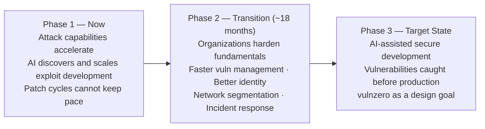

Every enterprise security program I have seen is built on the same implicit assumption: there is time. Time to triage the CVE. Time to validate the patch in staging. Time to get change control approval. Time to coordinate the maintenance window. Time to confirm nothing broke after the fact.

That assumption is getting demolished.

Anthropic's deputy CISO, Jason D. Clinton, issued a [public warning](https://x.com/JasonDClinton) framing the next 18 months as a critical transition window. The specific claim is that AI is changing the economics of vulnerability discovery in a way that breaks the patch velocity most organizations depend on. Finding a complex software flaw that once required a team of specialized researchers may become something that scales automatically, runs continuously, and costs next to nothing per find.

The vulnerability backlog that already exists in most enterprise environments is not the problem. The problem is that the rate of new discovery is about to accelerate faster than the rate of remediation.

## The Asymmetry That Actually Matters

The security conversation tends to focus on the sophistication of individual attacks. That's the wrong frame. The asymmetry that matters is time.

The window between a vulnerability being discovered and being actively exploited in the wild has been shrinking for years — multiple years of Microsoft MSRC and Verizon DBIR data show the same trend. Attackers don't need the same patch lag they once depended on. When an AI system can find a PHP deserialization flaw in a codebase overnight, and the affected organization needs three weeks to identify every system running the vulnerable version, validate the patch against its custom configuration, get sign-off from application owners, and deploy during the next maintenance window, the attacker wins before the defender finishes step one.

This is an operational tempo problem, not a tooling problem.

And it's worse for the systems that matter most. Hospitals, industrial control systems, financial networks and legacy platforms cannot always patch on demand. Regulatory requirements, physical safety constraints, and system stability requirements mean that patching may genuinely require weeks or months of preparation. AI doesn't care about your change control board.

## Clinton's Three-Phase Model

The Anthropic warning maps the transition in three phases, which I think is a useful operational frame even if the exact timeline is speculative.

The "vulnzero" framing in Phase 3 is explicitly an aspiration, not a guarantee. Clinton is not saying software will be vulnerability-free in 18 months. He is saying that AI-assisted static analysis, automated SAST pipelines, and AI-reviewed code could catch most vulnerability classes before software ever ships to production. That's the intended destination. Phase 2 is the bridge that has to be crossed first.

Phase 2 is where organizations will actually be operating over the next 18 months. The work is not glamorous. It is inventory, segmentation, patching processes, and incident response. The organizations that skip Phase 2 and jump straight to buying AI security products will be in the same position in two years.

## What the Basics Actually Mean at Scale

Clinton's most pointed recommendation is that security leaders should be asking their boards for investment in fundamentals, not new AI security tooling. Having spent time in large enterprise environments, I can tell you that "do the basics" sounds trivial until you see what the basics actually require at scale.

**Asset inventory** sounds simple. In a large enterprise running hundreds of services across multiple cloud providers, with legacy on-prem workloads, acquired subsidiaries on different stacks, and shadow IT that nobody fully catalogued, knowing every internet-facing system running a specific library version is genuinely hard. Most organizations cannot answer this question in under a week for a critical CVE. That's the gap.

**Risk-based patching** sounds rational. It requires knowing which assets are actually exploitable from the outside, which have compensating controls, which carry the most business risk if compromised, and which can tolerate downtime for patching. That requires a data model of your environment that most organizations don't have built.

**Network segmentation** sounds like a checkbox. Retrofitting meaningful segmentation into a flat enterprise network that grew organically over 15 years is a multi-quarter program with real application compatibility risk.

These are not technology problems. They are operational discipline problems that require sustained investment and organizational will. AI accelerating the threat landscape does not make them easier. It makes the cost of skipping them higher.

## The Code Generation Angle

There is a compounding risk that doesn't get enough attention: the same AI tools accelerating vulnerability discovery are also accelerating code generation. Every line of AI-generated code that ships without proper security review is a line written at speed, by a system that has no accountability for what it produces, and that may be systematically repeating patterns from training data that include known vulnerability classes.

The teams building AI coding pipelines right now should be treating AI-generated code the same way they treat code from an inexperienced contractor: it needs review, it needs SAST, and it needs someone who actually understands what the code is supposed to do checking that it does that and nothing more.

Specification-driven development (SDD) gives a partial answer here. When the specification is written before the code, the AI has a contract to implement rather than an open-ended prompt. The implementation can be diffed against the spec. Deviations are visible. That's not a complete security posture, but it's a structural improvement over letting an agent write code against a vague brief and hoping for the best.

## The Practical Priority Order

For any organization that has been deferring the fundamentals, the priority order is straightforward:

| Priority | What it means operationally |
|----------|----------------------------|
| Internet-facing asset inventory | Know what you're running and which versions. Automate this — manual spreadsheets are stale before they're finished. |
| Critical CVE patching | Establish a track for actively exploited, high-impact flaws that bypasses normal change control timelines. Have a process, not an ad-hoc panic, when a zero-day drops. |
| Identity and access | MFA everywhere, privileged access reviewed, service account proliferation audited. Identity compromise is the most common initial access vector across every incident report I've read. |
| Network segmentation | At minimum, segment crown-jewel systems from general-purpose infrastructure. Don't try to boil the ocean. |
| Incident response | Run a tabletop. Know who calls who when a breach is confirmed. Don't figure that out during the incident. |

The AI security product layer belongs on top of this foundation, not in place of it. A model that detects anomalous behavior in your network traffic is useful. A model deployed into an environment with no asset inventory, flat network topology, and no patching process is detecting anomalies in a system that is already fundamentally compromised in its design.

## When This Advice Doesn't Apply

Not every organization is starting from scratch. If your environment already has continuous CSPM coverage with real-time asset inventory, a mature vulnerability management process with SLA-enforced patching tracks, and tested segmentation in place, Clinton's Phase 2 advice is mostly already done. Focus on Phase 3: AI-assisted SAST in the development pipeline, AI-reviewed PRs, and automated policy enforcement in CI/CD.

This is also less acute for air-gapped environments. If your critical systems are physically isolated, the internet-facing discovery acceleration is structurally limited. The risk shifts to insider threat and supply chain, not remote exploitation at scale.

The 18-month framing is most relevant for organizations running hybrid environments with significant legacy debt, internet-facing services across multiple cloud providers, and a patching process built around quarterly maintenance windows.

## Decision Rule

Invest in Phase 2 fundamentals if: you cannot answer "which of our systems is running this library version?" within 24 hours, your change control process for critical patches runs more than one week, or your network has no meaningful segmentation between internet-facing and internal systems.

Hold off on AI security products as a first move until the asset inventory, patching SLA, and segmentation work is done. A detection model in a flat network with no patch process adds overhead without closing the gap.

The window is already shrinking. The question is whether the next 18 months go toward building that foundation or toward explaining to a board why it wasn't done.
