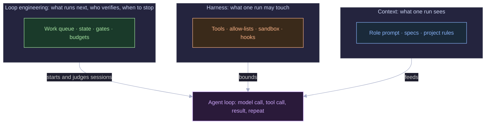
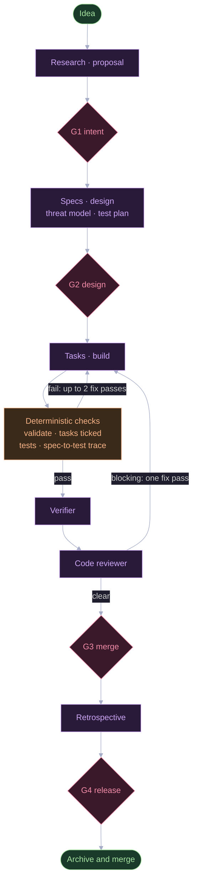

In one change on my agentic delivery pipeline, at least six consecutive implementer sessions reported the same three tasks as still open. Every guard I had configured worked: the retry counters capped the passes, the budget cap held, and the run ended. Yet nothing in the system noticed it was going in circles, and a human revision restarted the same cycle.

That run changed how I use the word *loop*. In my [August post]() I used it for the turn-by-turn cycle inside one agent: call the model, run a tool, feed the result back. That meaning is still valid. But the industry has since taken the same word for something one level up, and my pipeline lives almost entirely in that upper level. Below I correct my own terminology, then use two real runs, with their costs and failures, to show what the upper level looks like when it breaks.

I'll say up front what this is. The evidence is two changes on one small todo app, run on my laptop through a pipeline I wrote. It is a small sample from one system, not a benchmark. The mechanisms are what generalize, so those are what I'll focus on.

## Two things people call a loop

**Loop engineering, in the 2026 sense, is the system that decides what an agent works on next, checks the result and decides what happens after that.** Addy Osmani [named and defined it in an essay on 7 June 2026](https://addyosmani.com/blog/loop-engineering/). His description is a system that finds work, assigns it, checks it, records progress and decides what comes next, so that the system prompts the agents and you don't. He places it relative to the harness in one line: loop engineering "sits one floor above the harness."

What I wrote about in August is the inner loop. The model is called, it asks for a tool, the harness checks permission, the tool runs, the result goes back, and the cycle repeats until the model stops or a cap is hit. Call that the **agent loop**. It runs inside a single session.

The two operate at different scales and fail differently:

| | Agent loop (inner) | Loop engineering (outer) |
|---|---|---|
| Unit of work | One model turn | One task, change or ticket |
| Lives in | A single session | The system that starts and ends sessions |
| Decides | Which tool to call next | What to work on, when to retry, who verifies, when to stop, when to ask a human |
| Typical stop condition | `end_turn`, iteration cap | Verified result, retry budget, cost cap, human gate |
| Typical failure | Runaway tool calls | Retrying what cannot succeed, accepting "done" without proof |

Other write-ups describe the same split. [codecentric](https://www.codecentric.de/en/knowledge-hub/blog/loop-harness-context-engineering-explained) stacks three layers: context engineering at the bottom, harness engineering in the middle, loop engineering on top. [Future AGI](https://futureagi.com/blog/loop-engineering/loop-engineering-vs-harness-engineering/) gives a diagnostic I'll use later: if a bad run "tried the right thing and could not execute it cleanly," suspect the harness, and if it "kept repeating itself," suspect the loop. The sources disagree on some boundaries, and the terms are only a few months old, so treat any single definition, including mine, as provisional.



## The pipeline I'm describing

**My pipeline is an outer loop with ten agent roles and four human gates.** The kit is a Node runner with no dependencies ([`bin/agentic.mjs`](https://github.com/shanmuga-sundaram-n/openspec-agentic-kit/blob/main/bin/agentic.mjs)). It takes a one-line idea and drives it through research, proposal, specs, design, threat model, test plan, tasks, build, verification, code review and a retrospective. Each role runs as its own headless Claude Code session, and the roles hand work to each other only through the files in an [OpenSpec](https://github.com/Fission-AI/OpenSpec) change folder. The kit is open source as [openspec-agentic-kit](https://github.com/shanmuga-sundaram-n/openspec-agentic-kit), and I quote only small pieces of it below. Its run logs and state files are git-ignored, so the cost and failure figures in this post come from my local runs, not from files you will find in the repository.

It is a second implementation of the idea in my [SDLC Factory post](). The factory passed validated JSON artifacts between agents inside one application. The kit leans on Claude Code for the agent loop and on markdown files in a git worktree for the contract, so the code I wrote is almost entirely the outer loop.



Four properties of that design carry the rest of the post:

- **State lives outside the model.** Each session starts with a clean context. What persists is the change folder, a `state/*.json` file per change, and a SQLite store that feeds a dashboard. This corresponds to the state layer in Osmani's list, which keeps progress outside the conversation.
- **The runner picks the next step from `openspec status`**, not from anything an agent says. An artifact counts as done when the file exists and validates, not when the agent claims it wrote it.
- **Checks between agents are plain code** (see [`lib/checks.mjs`](https://github.com/shanmuga-sundaram-n/openspec-agentic-kit/blob/main/lib/checks.mjs)). `openspec validate --strict`, whether every task is ticked, the project's test command, and a trace that every requirement ID has at least as many test references as it has scenarios. No model is involved.
- **Gates scale with risk.** The product analyst sets a risk tier in the proposal. For low-risk changes G2 and G4 approve themselves when nothing blocks. For medium and high risk, a human approves all four.

The relevant limits from [`config.base.json`](https://github.com/shanmuga-sundaram-n/openspec-agentic-kit/blob/main/config.base.json) are small enough to quote:

```json
{
  "maxApplyPasses": 3,
  "maxFixAttempts": 2,
  "autoFixReviewBlocking": true,
  "agent": { "maxBudgetUsdPerRun": 5, "timeoutMinutes": 45 }
}
```

## Osmani's building blocks, mapped to the kit

**Osmani's list of loop primitives maps onto the kit almost one to one, which is how I knew I was building the same thing under a different name.** The mapping below is mine, not his, and where the kit has no equivalent I've said so.

| Osmani's primitive | What it is in the kit | Gap |
|---|---|---|
| Automations (scheduled discovery and triage) | The runner's `drive` loop, started by me from the CLI or dashboard | Nothing triggers a change on its own; I start every one |
| Worktrees | One git worktree per change, on branch `change/<id>` | One implementer at a time; no parallel lanes |
| Skills | Ten role prompts plus OpenSpec's per-artifact instructions and templates | None |
| Plugins and connectors | None | No tracker or chat integration |
| Sub-agents (write and verify separated) | Verifier and code reviewer run as separate sessions from the implementer | None |
| State | Change folder, `state/*.json`, SQLite, `approvals.md` | None |
| Memory across runs | Retrospective lessons, queued as `pending` until I accept them | Lessons only add rules; nothing retires old ones |

The two gaps matter. With no automation, I'm the scheduler, and that kept the sample small. With a single implementer lane, two changes can't build at once.

## Two real runs

**Two changes cost about $6 each and about 25 minutes of agent time, and about a third of that spend went on checking the work.** Both ran against a small todo app. The first added create, edit, complete and delete for todos. The second added a basic password login, which the Product Analyst classified as high risk. The figures below come from the per-run logs the kit writes: every agent run's prompt, exit code, seconds and cost.

| | Todo CRUD | Login flow |
|---|---|---|
| Agent runs | 23 | 22 |
| Total agent cost | $5.75 | $6.17 |
| Total agent time | 1,415 s | 1,541 s |
| Implementer | 10 runs, $1.68 | 8 runs, $1.89 |
| Code reviewer | 2 runs, $1.68 | 2 runs, $1.61 |
| Verifier | 2 runs, $0.34 | 2 runs, $0.38 |
| Reviewer + verifier share of spend | 35% | 32% |

Two things stand out. The reviewer, a different session with a different prompt, cost as much as the implementer on the first change and nearly as much on the second. The most expensive single run in the login change was the implementer's first pass ($1.42, 135 turns). In the todo change it was the first code review ($0.90), just ahead of the first build pass ($0.85, 84 turns). The build pass is the inner agent loop. Everything else is the outer loop deciding what to do around it.

None of this is a general claim about cost. It's what two small changes cost, with the model settings in my config. The ratios are the useful part: independent checking was not a rounding error in the budget.

## What the traces taught me

### Retries aimed at work that cannot succeed

**A retry counter bounds a stuck loop, but it can't tell you the loop is stuck.** In the todo change, tasks 6.7, 7.2 and 7.3 were manual checks: build the project, start the server and run a smoke flow with `curl`. The implementer's tool allow-list has `npm` and `node` but no `curl`, and the headless session has no way to approve a command it isn't allowed. Each implementer session said so in its final message:

> Tasks 6.7, 7.2 and 7.3 are still unticked. I couldn't run the server, so none of them has the evidence it needs.

The runner's check, "all tasks ticked," failed every time, so it kept going: up to three build passes, up to two fix passes, then, after I requested a revision at G3, the same sequence again. Across the two cycles, at least six sessions reported the same three tasks open; all ten implementer runs ended with them unticked. The login change had the same shape with a single task, 6.2.

The money was small. Counting every implementer run after the first build pass, the retries cost $0.83 on the todo change and $0.46 on the login change, roughly 14% and 7% of each total. Those figures are an upper bound: they include the build pass after my G3 revision and the review fix, which were legitimate work, and some other retries ticked tasks too (one ticked 7.4). The cost isn't the point. The loop ran the same experiment repeatedly and expected a different result, and no component compared one pass with the next.

Here is the detector I would add. It compares the set of open tasks after each pass and stops retrying when the last `window` passes left the same ones open. I ran it against the six-pass pattern above:

```js
// Stop retrying when the last `window` passes left exactly the same tasks open.
export function stalled(history, window = 2) {
  if (history.length < window) return false;
  const key = open => [...open].sort().join('|');
  const recent = history.slice(-window).map(key);
  return recent.every(k => k === recent[0]);
}

// Illustrative input: the same three tasks reported open on every pass,
// as the agents' final messages did in the todo change.
const passes = Array(6).fill(['6.7', '7.2', '7.3']);
const history = [];
for (const [i, open] of passes.entries()) {
  history.push(open);
  console.log(`pass ${i + 1}: open=${open.join(',')}  stalled=${stalled(history)}`);
}
```

```text
pass 1: open=6.7,7.2,7.3  stalled=false
pass 2: open=6.7,7.2,7.3  stalled=true
pass 3: open=6.7,7.2,7.3  stalled=true
pass 4: open=6.7,7.2,7.3  stalled=true
pass 5: open=6.7,7.2,7.3  stalled=true
pass 6: open=6.7,7.2,7.3  stalled=true
```

With `window = 2` it would have saved three of the five implementer sessions in the revision cycle, where every pass reported the same three tasks. In the first cycle the open set varied early on (7.4 was also open after the first pass), so it would have saved about one. The saving is bounded by the caps already in place, and `window` is a real trade-off: in the login change the open set was identical on two consecutive passes, and a later pass still closed task 5.3, so `window = 2` would have stopped one pass too early. The bigger win is upstream: a task that no agent can complete should not enter the agent queue. A `[manual]` marker in `tasks.md` that routes the task to the gate summary as a human to-do would remove the whole class. I haven't built either; both are proposals.

### Rate limits arrive as loop events

**A quota error is not a failed task, and treating it as one wastes the retry.** On the login change, the spec author and the architect ran in parallel, because the runner starts independent artifacts together. Both sessions ended with `You've hit your session limit` and exit code 1. Their partial runs cost $0.29 and $0.50. The runner's second attempt for each lasted five seconds and cost nothing, and the change stopped there. I resumed it the next morning.

The parts that worked are worth noting. The runner only trusts a file that exists and validates, so on resume it found the specs and design present and moved on to the threat model without redoing them. I haven't audited whether those artifacts were complete when the limit hit; the next agents consumed them without complaint, and that is the extent of what I can say.

The parts I would change: two parallel sessions share one account quota, so they fail together. And the retry should recognize this error and pause the change instead of burning a second attempt. A harness-level error and a loop-level policy meet right there.

### "Done" is a claim until something else checks it

**In both changes the checks, not the implementer, were what separated done from claimed.** The implementer's final message in the login change said 29 of 30 tasks were complete and the tests passed. The deterministic checks agreed with the first part (`tasks complete` failed at 29/30) and with the second (159 tests passing).

The independent reviewer found something the green tests hadn't. After the first build and fix passes the suite passed with 158 tests, and the verifier had not flagged anything in the limiter. The code reviewer, reading the diff against the specs and the threat model, raised one blocking finding: the login rate limiter counted a failed attempt only after the slow password hash finished, so parallel attempts from one address would all pass the check before any failure was recorded. Its estimate was tens of guesses per second against a limit of 5 per 60 seconds. The runner's one automatic review-fix pass added a test (`AUTH004 concurrent wrong passwords are limited before hashing completes`) and fixed the code. The fresh review afterwards found zero blocking issues.

This is Osmani's sub-agent point in practice: agents tend to grade their own work generously, so the agent that writes should not be the only one that judges. It is also why review took a third of the spend. I'd keep that ratio.

### Gates are only as good as what the human does at them

**The loop correctly surfaced every problem and then let me approve past it, which means the stop condition was me.** Three records from the login change show it:

- The threat-model agent wrote that its output "blocks approval," with two high-severity gaps: the spec and the design disagreed on routes, error codes and limiter behavior (GAP-01), and no change to the existing `todos` spec said that every todo request without a session should get a 401 (GAP-02). G2 for this high-risk change was approved 19 seconds after the test plan finished, with an empty note. Both gaps were still open at the end and appear in the verifier's blocking list.
- At G3 the checks showed `tasks complete` failing and the verifier's verdict was still FAIL. Per the [README](https://github.com/shanmuga-sundaram-n/openspec-agentic-kit/blob/main/README.md#gates), approving with a failing check takes an explicit override. I approved with the note "Skip Manual run and update done."
- The retrospective agent, which runs after G3, flagged both and proposed rules for the next change: require scenarios for threat-model controls, require a delta spec when an existing capability changes behavior, and record a written waiver for manual tasks.

The gate worked in the sense that it listed the blockers, made override a deliberate act and recorded it in `approvals.md`. It did not make me read them. A human gate is a stop condition with exactly the reliability of the human at it, and the pipeline had no mechanism to notice that a rubber stamp had happened.

## Which layer to fix

**For each failure above, the cause and the fix sit at different layers, and diagnosing the layer first saves you from tuning the wrong thing.** I use Future AGI's rule of thumb: describe the last bad run and see which sentence fits.

| Failure | What it looked like | Layer | Fix |
|---|---|---|---|
| Six sessions, same three tasks open | The loop kept repeating itself | Loop | Compare consecutive passes; stop on no progress |
| Agent could not start the server | It tried the right thing and could not execute it | Harness | Add a narrowly scoped `curl` to localhost to the implementer's allow-list, or run smoke checks as a deterministic step |
| Manual tasks in the agent queue | Work was assigned to something that cannot do it | Loop | `[manual]` marker; route to a human at G3 |
| Session limit | A model-provider limit, handled as task failure | Both | Recognize the error; pause and resume instead of retrying |
| Parallel agents died together | Shared quota, no backpressure | Loop | Lower parallelism when a quota error appears |
| Approved past blockers | The stop condition was a human who didn't read | Loop (gate design) | Require a written reason for each open blocker at override |

The harness fix has a cost I should state plainly. Each command I add to a role's allow-list widens what an unattended session can do. A `curl` limited to `127.0.0.1` is a small widening, but it is still a widening, and I'd rather see the smoke check run by the runner as a deterministic step than hand the agent more reach.

The overlap between the layers shows up here. The stall detector needs a signal from the harness (which tasks are ticked), and the session-limit fix needs the harness to report a typed error rather than a string in the agent's final message. Future AGI makes the same point when it notes that stop conditions depend on signals the harness reports. In my kit, the runner is both: it provisions the worktree and allow-lists (harness) and decides what runs next (loop). I'd call that a smell worth watching, because the two layers want to change at different speeds.

## Where this does not fit

- **Small or exploratory work.** A one-line change doesn't need research, a threat model and four gates. For work you'd finish in one supervised session, the outer loop is overhead. Osmani himself calls the idea promising but early and says he is skeptical.
- **Review bandwidth.** He names it as the real limit on how many agents a person can run, and my pipeline agrees. The expensive part of each change wasn't tokens. It was me reading a research doc, a proposal, specs, a design, a threat model, a test plan, a diff, a verification report and a review report at four gates. When I read them thinly, as I did at G2, the structure produced documents and not safety.
- **Comprehension debt.** The kit ships code I did not write line by line. The gate summaries help, but I can't claim I understand the login implementation the way I'd understand code I wrote. Osmani's phrase for the temptation is cognitive surrender, and I recognise it from the G2 timestamp.
- **My sample.** Two changes, one app, one operator, one model configuration. The costs and the retry pattern could look different on a larger codebase or with a different test suite.
- **No parallel lanes.** Real loop systems run many tasks at once. This one doesn't, so I've said nothing about contention between worktrees.

## Decision rule

Build an outer loop when the work is repeatable, has a check that doesn't depend on the agent's word, and is big enough that supervising each step costs more than reviewing the results. Skip it when you'd supervise every step anyway.

If you already have one, three questions find most of the problems I hit:

1. **What compares one pass with the next?** If the answer is "a retry counter," a stuck loop will run to its limit every time.
2. **Who checks "done," and is it a different session from the one that did the work?** If not, the check is a second opinion from the same author.
3. **What stops the loop, and does that stop condition read the evidence?** A human gate that approves on a summary is only as strong as the reading behind it.

My next changes to [the kit](https://github.com/shanmuga-sundaram-n/openspec-agentic-kit), in order: the no-progress check, a `[manual]` task class, and a written reason required for every override. Then I'll run another two changes and see whether the numbers above move.
