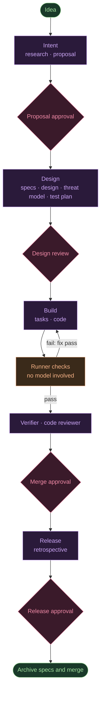

Ten AI agents write the research, specs, design, tests and code for one change in my delivery pipeline, and none of them decides what happens next. A plain Node program does. It reads a status command, starts the next agent, runs checks that involve no model, and stops at four points where a human has to say yes. The model still produces the inputs to those decisions, and I mark where that matters.

This post opens that program up. It is about 2,150 lines of JavaScript with no npm dependencies, and it is [open source](https://github.com/shanmuga-sundaram-n/openspec-agentic-kit). I wrote about what happened when I ran it in [a separate post](), including a stuck loop and an override I regret. Here I stay with the code and the design reasons, because they are the part you can reuse.

**How to read this.** If agents and specs are new to you, start at the next section and read through "One idea, start to finish". If you write code, jump to "A session is a function call". If you design systems, the sections on gates, the trace check and "Where this does not fit" carry the trade-offs. Terms are defined where they first appear.

## The runner decides, the agents write

**The reliable parts of a multi-agent pipeline are the parts where the model gets no vote.** In this kit, an agent never chooses the next step and never directly approves a gate. The model writes files, and code decides what happens around those files. The model does still supply some inputs to those decisions: it ticks its own task checkboxes, it proposes the risk tier, and it writes the review that can block a merge. Those are the weak points, and a later section lists them.

That split gives four properties:

- **Control flow is ordinary code.** The loop that moves a change through stages is a `while` loop in [`bin/agentic.mjs`](https://github.com/shanmuga-sundaram-n/openspec-agentic-kit/blob/main/bin/agentic.mjs). You can read it, test it and step through it in a debugger.
- **A document is "done" when the file exists and validates.** The runner asks the OpenSpec CLI whether an artifact is finished. It does not take the agent's word for it.
- **Checks are deterministic.** Validation, task completion, the project's test command and a spec-to-test trace all run as code.
- **Humans approve at fixed points.** Four gates, with a policy that depends on a risk level.

Each agent is a *fresh headless session*: a new `claude -p` process with an empty context that runs one job and exits. Agents never talk to each other. They read and write one shared folder. If you are a beginner, think of it as a relay race where the baton is a directory of Markdown files and the referee is a script.

## OpenSpec in five minutes

**OpenSpec is a spec-driven development framework: you and the AI agree on what to build, in writing, before any code is written.** It is MIT-licensed, installs from npm as `@fission-ai/openspec` (Node 20.19 or later) and, per its [README](https://github.com/Fission-AI/OpenSpec), works with 30-plus AI coding assistants through slash commands. I used version 1.15.0 in October 2026.

It adds a plain-Markdown layer to a repository, with four ideas:

| Concept | What it is |
|---|---|
| **Spec** | A Markdown file of requirements, each with scenarios written as WHEN/THEN. Specs live in `openspec/specs/` and describe what the system does today. |
| **Change** | One folder per feature or fix under `openspec/changes/<id>/`. Proposed work stays separate from the current truth. |
| **Delta spec** | Inside a change, a spec file that lists only what is `ADDED`, `MODIFIED`, `REMOVED` or `RENAMED`, instead of rewriting a whole spec. |
| **Archive** | When a change is done, it moves to `openspec/changes/archive/` and its deltas merge into the main specs, so the specs keep up with the code. |

A change holds `proposal.md` (why and what), `specs/` (the deltas), `design.md` (how) and `tasks.md` (a checklist). Here is a small delta spec, in the format the CLI validates:

```markdown
## ADDED Requirements

### Requirement: PAY-012 Refund window
The system SHALL allow a partner to refund a settled payout within 30 days of settlement.

#### Scenario: Refund inside the window
- **WHEN** a partner requests a refund 10 days after settlement
- **THEN** the refund is created and the payout balance is reduced

#### Scenario: Refund outside the window
- **WHEN** a partner requests a refund 31 days after settlement
- **THEN** the request is rejected with the error code REFUND_WINDOW_CLOSED
```

The core flow uses `/opsx:explore`, `/opsx:propose`, `/opsx:apply` and `/opsx:archive`, and an expanded profile adds `/opsx:verify`, `/opsx:ff` and others. The README compares itself with GitHub Spec Kit (more phases, more setup) and Kiro (tied to one IDE). That is the project's own positioning, so weigh it as such.

What OpenSpec does not give you is an orchestrator. It has no loop that runs the next step, no cost cap, no approval gates and no tests that tie requirements to code. That gap is what the kit fills, and it does so with three pieces of OpenSpec's own machinery:

1. **A custom schema.** OpenSpec lets you define the artifact list. The kit's `agentic-sdlc` schema adds `research`, `threat-model`, `test-plan`, `verification` and `retrospective` around the default four.
2. **`openspec status` as the scheduler.** The runner asks which artifacts are ready.
3. **`openspec validate --strict` as a check.** It is one of the deterministic gates between agents.

## One idea, start to finish

**A change moves through four stages, and each stage ends at a human gate.** Say you type this:

```bash
node bin/agentic.mjs start "Partners can refund settled payouts within 30 days" --repo payments-api
```

The runner creates a git worktree (a second checkout of your repo on its own branch, `change/<id>`) and works there, so your main checkout stays untouched. Then it walks the stages:



In words: each of the four stages ends at a human gate, and the build stage loops through the runner's checks until they pass or the retry budget runs out. Here is what lands in the change folder along the way:

| After stage | New files in `openspec/changes/<id>/` | Written by |
|---|---|---|
| Intent | `research.md`, `proposal.md` | Product Analyst |
| Design | `specs/…/spec.md`, `design.md`, `threat-model.md`, `test-plan.md` | Spec Author, Architect, Security Reviewer, Test Strategist |
| Build | `tasks.md`, the code, `verification.md`, `review.md` | Planner, Implementer, Verifier, Code Reviewer |
| Release | `retrospective.md`, and `approvals.md` throughout | Retrospective analyst, and the runner |

At each gate the runner prints what to review, and you approve or ask for changes. When you approve with a note, that note is stored and handed to every later agent as a binding decision. When you ask for changes, you pick the stage that should absorb them. Your feedback goes to the agents of that stage, later stages get an "upstream was revised" note, and the gate of that stage and every gate after it reset.

## A session is a function call

**Every agent run is one function, `runAgent`, that spawns `claude` with explicit limits and returns text, cost and seconds.** This is the whole contract between the runner and a model, abridged ([`lib/agent.mjs`](https://github.com/shanmuga-sundaram-n/openspec-agentic-kit/blob/main/lib/agent.mjs)):

```javascript
const args = ['-p', '--output-format', 'json', '--agent', role,
              '--permission-mode', a.permissionMode || 'acceptEdits'];
if (a.permissionPrompts) args.push('--permission-prompts', a.permissionPrompts);
if (a.maxBudgetUsdPerRun) args.push('--max-budget-usd', String(a.maxBudgetUsdPerRun));
if (r.model) args.push('--model', r.model);
// --allowedTools is variadic, so it goes last; the prompt is sent on stdin.
if (r.allowedTools?.length) args.push('--allowedTools', ...r.allowedTools);
```

For beginners, each flag does one thing:

- `-p` runs Claude Code non-interactively and prints the result, with no chat window.
- `--agent <role>` loads a role prompt from `.claude/agents/<role>.md`, such as the Architect or the Code Reviewer.
- `--model` picks the model for that role. The shipped config gives the creative roles (analyst, spec author, architect, security reviewer, code reviewer) `opus` and the mechanical ones (test strategist, planner, implementer, verifier, retrospective) `sonnet`.
- `--allowedTools` is an allow-list. The Code Reviewer gets `Read`, `Write`, `Glob`, `Grep` and read-only git commands. It has `Write` because it must write `review.md`, but no `Edit` and no `npm`. That is not a hard read-only guarantee: `Write` can overwrite any file in the worktree, so "the reviewer does not change code" rests on its prompt, plus the diff the runner commits afterwards. Only the Implementer and the Verifier get `npm`, `npx` and `node`, because both run the tests.
- `--permission-prompts none` means that nobody answers permission prompts, so anything outside the allow-list is denied. I checked these flags against the installed Claude Code 2.1.310 with `claude --help`.
- `--max-budget-usd` caps spend for one run, which is $5 by default here, and the process also has a 45-minute timeout.

For developers, two details matter. The prompt goes in on stdin, and the output is JSON, so the runner reads `total_cost_usd` and an error flag instead of scraping text. And every run writes a log file with the prompt, arguments, output, seconds and cost, which is how I got the numbers later in this post.

For architects, the design choice is that the *runner* owns the commit. No allow-list names a git command that writes, and the runner calls `git.commitAll` between steps, so the history is a record of pipeline events. Treat that as direct protection only: `Bash(node *)` and `Bash(npm *)` can run arbitrary scripts, so an agent that wanted to could still reach git that way. The permission model is a bet, and I come back to it at the end.

Every prompt also carries one headless rule: nobody will answer questions, so make the most reasonable assumption and list anything a human must decide under "Open questions". Those lists show up at the gates, and they are one of the more useful things the agents produce.

## The OpenSpec CLI picks the next step

**The runner never asks an agent what to do next. It asks `openspec status`.** For each artifact the CLI reports `done`, `ready` or blocked by missing dependencies. The runner starts every `ready` artifact in the current stage, and `Promise.allSettled` runs them in parallel when there is more than one (abridged):

```javascript
const ready = pending.filter(a => os.artifactState(st, a)?.status === 'ready');
if (config.parallelArtifacts && ready.length > 1) {
  const results = await Promise.allSettled(ready.map(a => runArtifact(state, a, null)));
  const err = results.find(r => r.status === 'rejected');
  if (err) throw err.reason;
}
```

After each run, `runArtifact` checks status again. If the agent said it was finished but the file is missing or invalid, that counts as a failed attempt, and the artifact gets one retry with an extra line saying what was missing. After the second miss the change stops with a `resume` command in the message. Running artifacts in parallel against one worktree is safe only because each artifact writes its own files; if two roles ever wrote the same path, this design would need locking.

The trade-off is a dependency on the OpenSpec CLI's JSON output. If its status format changes, the runner breaks. I accept that because the alternative, tracking artifact state myself, would duplicate what the CLI already knows.

## Stages and gates are data

**Stages, roles and gate policies live in `config.base.json`, not in code.** The loop does not know that there are four stages. It reads a list (abridged, with names, titles and approvers left out):

```json
{
  "stages": [
    { "id": "intent", "artifacts": ["research", "proposal"], "gate": "G1" },
    { "id": "design", "artifacts": ["specs", "design", "threat-model", "test-plan"], "gate": "G2" },
    { "id": "build",  "artifacts": ["tasks"], "apply": true, "checks": true,
      "after": ["verification"], "review": true, "gate": "G3" },
    { "id": "release", "artifacts": ["retrospective"], "gate": "G4", "archive": true }
  ],
  "gates": {
    "G2": { "label": "Design review", "policy": { "low": "auto", "medium": "human", "high": "human" } }
  }
}
```

The policy is a matrix of gate by risk level. The Product Analyst writes a `Risk tier: low|medium|high` line in the proposal, with a rule that money movement, auth, personal data or irreversible migrations are high. A human can change the tier at the first gate.

| Gate | Low risk | Medium | High |
|---|---|---|---|
| Proposal approval | human | human | human |
| Design review | auto | human | human |
| Merge approval | human | human | human |
| Release approval | auto | human | human |

Two rules govern `auto`:

- **Auto-approval only fires when nothing blocks.** If a check failed or the reviewer flagged a blocking issue, the gate waits for a human, whatever the policy says. Be careful with what that buys you. Checks and review only run in the build stage, which ends at Merge approval, and that gate is human at every risk level. So with the shipped config, "nothing blocks" is trivially true at Design review and Release approval, and the `auto` setting depends entirely on an honest risk tier.
- **Blocked gates need an explicit override.** The prompt says "type override to approve anyway", and the decision is recorded in `approvals.md` as an override, with who and when.

Config is layered: `config.base.json`, then `repos/<name>/repo.json`, then `repos/<name>/overrides.json`. Objects merge key by key and arrays are replaced. A payments repo can tighten its gates or restrict approvers by git email without touching the base.

For architects, the point is that governance is a data change. Making design review mandatory for every risk level is a one-word edit, and it is auditable in git. The limit is that the risk tier is itself an agent's judgement, read by a regex from `proposal.md`. A wrong "low" lets the Design and Release gates approve themselves, so the human at the first gate is the real control, which is why that gate is human at every level in the shipped config.

The kit also keeps your repository clean. On every start and resume it copies the agents, the schema and a rendered `openspec/config.yaml` into the worktree, then hides them with `.git/info/exclude`. If your repo already tracks one of those files, the runner leaves it alone, and it prints a warning for the config file.

## The spec-to-test trace

**The trace is a cheap check that every requirement has tests pointing at it, and it is strong evidence of structure and weak evidence of correctness.** It lives in [`lib/checks.mjs`](https://github.com/shanmuga-sundaram-n/openspec-agentic-kit/blob/main/lib/checks.mjs) and runs with no model.

The convention has two parts. Every requirement name starts with an ID, like `PAY-012`. Test names embed the same ID without the hyphen, like `PAY012`. The check parses the delta specs, then scans test files:

```javascript
const token = new RegExp(`${r.area}[-_ ]?${r.num}`, 'i');
let refs = 0;
for (const c of contents) for (const line of c.split('\n')) if (token.test(line)) refs++;
const need = Math.max(1, r.scenarios.length);
// ok when refs >= need and every scenario name appears in test-plan.md
```

So a requirement with two scenarios needs at least two matching lines in test files, and each scenario's name must appear in `test-plan.md`. A requirement with no ID is reported as a problem. The three other checks are `openspec validate --strict`, "every task in `tasks.md` is ticked" and your own test command.

What it proves is that no requirement was silently dropped between the spec, the plan and the tests. That matters because an agent can leave a requirement out of its tests and still report success.

What it does not prove is that a test asserts anything. The match is a regex over lines, so a comment containing `PAY012` counts as a reference. An agent under pressure could satisfy it without a real assertion. The Implementer prompt forbids weakening tests, and the Code Reviewer is asked whether tests assert real behaviour, but those are model judgements layered on a string match.

My two real runs show the other limit. Both passed the trace (12 requirements across 11 test files, and 9 across 24). Both also finished with tasks still open: three on the first change and one on the second. All four open tasks needed a running server, and the Implementer's session could not start one. A regex over test files cannot see a task that no test expresses.

## The build loop

**The build stage is two nested loops with hard caps, so an agent that cannot succeed runs out of attempts instead of money.** The outer loop is passes, from `buildUntilTasksDone`:

```javascript
// abridged
for (let pass = 1; pass <= (config.maxApplyPasses || 3); pass++) {
  const t = checks.tasksComplete(state.workdir, state.id);
  if (t.ok && !(revision && pass === 1)) return;
  await runImplementer(state, { revision: pass === 1 ? revision : null, label: `apply-${pass}` });
  git.commitAll(state.workdir, `wip(${state.id}): implementation pass ${pass}`);
}
```

Then `checkAndFix` runs all four checks. If any fail, the Implementer gets the failure text and tries again, up to `maxFixAttempts` (2). Then the Verifier writes `verification.md` from real test runs, and the Code Reviewer writes `review.md`. If the review has blocking findings, the Implementer gets exactly one automatic fix pass, followed by fresh checks, a rewritten verification and a second review.

The reviewer's verdict is read by code. The prompt requires four exact headings, and `reviewBlocking` pulls the bullets under `## Blocking`, ignoring "None". Note the failure mode: if `review.md` is missing, the runner records "review.md was not written" as a blocker. But if the file exists and the `## Blocking` heading is absent or misspelled, the function returns an empty list, which reads as no blockers. That is a fail-open edge I have not fixed. A stricter parser would treat a missing section as a blocker.

### What a change costs

The runner records cost and seconds for every session. I analysed those numbers per phase in [the companion post](), so here is only the shape, from two changes on one small app (not a benchmark):

| | Add/edit/delete todos | Login flow |
|---|---|---|
| Agent sessions | 23 | 22 |
| Total agent cost | $5.75 | $6.17 |
| Share spent on build and fix passes | $1.68 | $1.89 |

Two design points follow for developers and architects. The caps are what make this affordable to leave unattended: three apply passes, two fix attempts, one review-fix pass and $5 per session give you a ceiling you can estimate in advance. And review spend is a real lever, at about as much as the build and fix passes combined, but cutting it removes the only check that reads the diff.

## Lessons: learning with a human in the queue

**The retrospective agent can propose rules for next time, but nothing takes effect until a human accepts it.** The design is in [`lib/lessons.mjs`](https://github.com/shanmuga-sundaram-n/openspec-agentic-kit/blob/main/lib/lessons.mjs). The retrospective template ends with a fenced block tagged `json lessons`:

```json
{ "rules": { "specs": ["Name the error code in every negative scenario."] },
  "context": ["Tests run with an injected clock; never sleep in tests."] }
```

At release, the runner parses that block and queues each item in `repos/<name>/lessons.json` as `pending`, skipping duplicates. You review them with `lessons list`, then `lessons accept <id|all>` or `lessons reject`. Accepted rules are written into that repo's `openspec/config.yaml`, under the matching artifact, every time a change starts or resumes. The next change's agents then see them in their instructions.

I need to be straight about the evidence. My two real runs never exercised this. Their archived retrospectives use an older heading, "Proposed rule changes", and contain no `json lessons` block, so no lessons were queued.

There is also a bug I found while writing this. The `agentic-sdlc` schema's own instruction for the retrospective still says to write "Proposed rule changes … as YAML ready to paste", while the template and the agent prompt ask for the `json lessons` block. The agent receives both, and the old instruction probably explains the missing block. I have not fixed it yet. So I am describing a mechanism that is wired up but has never produced a lesson, and I have no data on whether accepted lessons improve later changes.

Its limits are known and written down. Lessons only add; nothing is retired automatically, so a repo's rules grow without bound and stale ones keep steering agents. One of the kit's own open change proposals, `lesson-retirement`, exists to add retirement, staleness flags and conflict detection. Lessons also never edit the agent prompts themselves.

## Cross-repo initiatives and the dashboard

**An initiative is one idea that touches several repos, run as one child change per repo with gates approved together.** You start it with `initiative start "<idea>" --repos payments-api,partner-web`. Each child runs the full pipeline in its own worktree. `initiative approve` refuses unless every active child waits at the same gate, so no repo is approved to merge ahead of the others.

Two limits matter for architects. The children draft their cross-repo contracts independently and do not read each other's artifacts, so you must compare the contract sections yourself at the first two gates. And merges happen per repo as each child finishes, not as one atomic release, so the rollout order has to be planned in the contracts. An `ordered-initiative-release` proposal for that is written but not built.

The dashboard (`node bin/agentic.mjs dashboard`) is a local page on `127.0.0.1` over a SQLite database, using Node's built-in `node:sqlite`, so it needs Node 22.13 or later. The JSON files in `state/` stay the source of truth, and the database is a cache you can delete and rebuild. It follows the same rule as the rest of the kit: the pipeline works without the dashboard, and the dashboard cannot corrupt the pipeline.

Here it is after my two real runs against a todo app. The top row counts changes by state, the table shows each change's four stages and gates, and the side panels show recent activity and spend by repo and by agent.


Opening a change shows its stepper, each stage's gate and the artifacts the agents wrote. This is the login change, showing `proposal.md`. The `checks` row under the build stage is red (3 of 4 pass) while every gate is approved, which is the override story in [the companion post]().


## Where the model still votes

**The runner owns control flow, but four inputs to it come from a model, and each is a place to harden.**

| Input | Who produces it | What depends on it | Hardening I would add |
|---|---|---|---|
| Task ticks in `tasks.md` | The Implementer | The "tasks complete" check | A `[manual]` task class that a human, not the agent, ticks |
| `Risk tier:` line | The Product Analyst | Which gates auto-approve | Keep the first gate human, as shipped |
| `review.md` | The Code Reviewer | The blocking list at Merge approval | Treat a missing `## Blocking` heading as a blocker |
| Test names with IDs | The Implementer and Test Strategist | The spec-to-test trace | Add mutation or coverage checks in `extraChecks` |

None of these lets a model approve a gate directly. All of them let a model make a check pass or fail by what it writes, and the risk tier can make a gate approve itself, which is why the first and third gates stay human.

## Where this does not fit

**This is a lot of machinery, and for many tasks it is the wrong tool.**

- **If you are learning, or the change is small**, a single interactive Claude Code session with an OpenSpec `/opsx:propose` and `/opsx:apply` gives you most of the benefit with none of the setup. The runner pays off when a change is big enough that an unattended hour matters.
- **If you are a developer on Windows**, the README says it was tested end to end on Linux, that macOS should behave the same, and that Windows has not been tested. One of the kit's open proposals is an audit of paths, shell commands and process termination. It also runs one Implementer at a time. A proposal for parallel implementation lanes is written but not built.
- **If you are an architect needing atomic release across repos**, the initiative model gives you linked gates but not a transaction. A failure between two repos' merges leaves you with a partial release.
- **If you cannot trust a regex-level trace**, you need real mutation testing or coverage gates in `extraChecks`. The trace is a floor.
- **The permission model is a bet.** Agents run with `acceptEdits` and a per-role allow-list, with prompts denied. That is safe against surprises in the tool list, not against a prompt-injected agent that has `Write` access to the worktree.

## Decision rule

**Put a deterministic runner around your agents when the cost of an unreviewed mistake is higher than the cost of the setup, and keep every decision about "done" and "approved" in code or in a human.**

- **Beginner:** try it in three steps. Install Node 20.19+, Claude Code and `@fission-ai/openspec`. Register a small throwaway repo with `repo add`. Run one change with a one-line idea, and read the files at each gate. You will learn more from the first `proposal.md` than from any summary.
- **Developer:** copy the shape, not the code. One function per agent run, explicit allow-lists, a cost cap and a log per session. Put every "is it done" test in a script.
- **Architect:** decide which gates must be human at every risk level, and write that policy as data. Then name the places where your checks are strings and not proofs, as I did for the trace and the review parser.

The same ideas appear one level up in my [harness engineering post](), which covers allow-lists and permissions in the single-agent case. My next changes to the kit, in order: make a missing `## Blocking` section a blocker, add a `[manual]` task class so a human-only check is not counted as an incomplete task, fix the retrospective instruction conflict, and run the lessons loop on real changes so I can report what it does.
